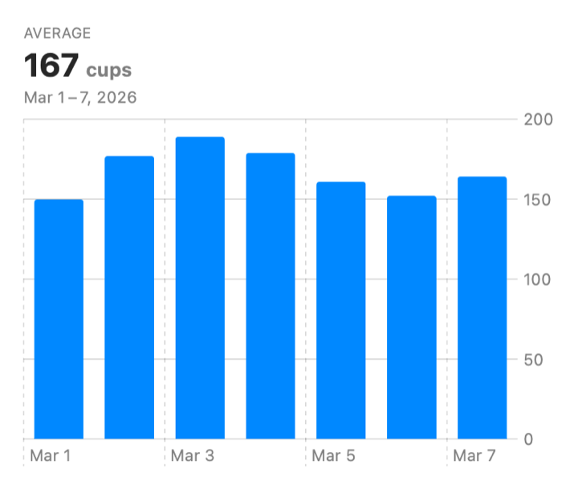

# Chart design

Deciding whether to chart, what to build, and how it fits the app. Each guideline names the API that carries it out, so a design decision becomes a line of code. It starts with whether to chart at all, then goes through the five things a chart is designed with (marks, axes, descriptions, interaction, colour), then how charts sit in an app.

## Whether to use a chart

- **Use a chart to highlight something about a dataset.** A chart draws the eye, so it should have a point: a trend, the current state of something that changes, or a comparison across items or across time.
- **If people only need the values, use a list or table** they can scroll, search and sort. A chart is for conveying information about the data, not for delivering it. A list needs no Charts code: a row per item that is one accessibility element (the date or name as its label, the amount with its unit as its value), and column headings that are buttons, sort, and say their direction as their value.
- **Charts earn their place** in three common cases: values over time, past or predicted; part of a whole, such as progress toward a goal; and comparison between items or categories.
- **Start from the goal, and narrow it.** Write the question the chart answers ("how were sales in the last 30 days?"), list what it could show (pattern, range, individual values, the maximum, outliers, comparisons), and choose the few that matter most to the people using it. An effective chart focuses on a few pieces of information. For example, "how did the last 30 days go?" over daily bars: the average (a labelled `RuleMark`), the weekends (at full strength, the rest faded) and the best day (a marked point carrying its date). The bars stay the same; each insight adds one layer, and the headline says each in a sentence.
- **Look at the data from three distances** for things worth showing: the whole (a total or an average, as a headline or a `RuleMark`), subsets (a period, a category), and single values (the best day, as a highlighted `PointMark` or an annotation).
- **Design with real data, and for its awkward cases.** A form that looks right on smooth invented data can fail on the real thing. Check days with zero, gaps, outliers and very small values, and the case of no data at all, or only zeros: an empty chart draws nothing, and a chart of zeros whose marks grow from zero (bars, areas, sectors) draws axes with no marks under a headline that is no longer true. Points at zero are still drawn, and so is a line, flat along the baseline, so a scatter plot or line of zeros is a chart, not an empty state. Show a placeholder that says why, such as `ContentUnavailableView` (iOS 17.0+; below it, a `Text` saying the same in the chart's place), in place of the `Chart` view, and make the headline and the chart descriptor's summary handle the same case. Disable the controls that would change or announce what the chart draws while the placeholder shows, except one that leads back to a chart, such as a mark that draws these values.
- **Keep it simple and let people ask for more.** Do not pack in everything available. Offer detail gradually: a period switch, a subset picker, a larger version behind a tap.

## Marks

- **Choose the mark by what the chart should communicate,** not by the shape of the data: bars for comparison and for totals per period, a line for change over time, points for individual values and how two properties relate. The full table is *Choosing a mark* in `marks.md`.
- **How bars are arranged changes what they say:** in a row along time, change; stacked, the parts of a total; side by side, a comparison between categories.
- **Lines overstate what lies between distant points.** With gaps or zero days, the segments joining far-apart values become more prominent than the values. A line joins every point it is given, so a date with no record becomes a straight segment, as if the day had happened; to break it there, give each unbroken run its own `series:` value (read on iOS), and keep the run's colour by not encoding it. Bars keep each day separate and show zeros without distraction, and when values are totals the amount of bar on screen matches the amount sold.
- **Combine marks when it adds clarity.** Points on a line show the trend and the individual readings together: `symbol` on a `LineMark` (`mark-modifiers.md`). A line over a faint filled area gives the trend more weight (`gallery/area.md`).
- **Add a dimension only when a question needs it.** Splitting bars by a second property answers "and how is each made up?". Leave the second encoding out unless that question is being asked.
- **Prefer common chart types.** People already know how to read bars and lines. A scatter plot is less familiar and may need a sentence of guidance. A novel form has to be taught, for instance by introducing its parts one at a time, and belongs at the centre of the app, not in a supporting chart.
- **Pie and donut charts** suit casual settings where precision is not critical and the point is how parts make up a whole. Their round shape is approachable and reads well large. Keep to 5 to 7 sectors and sum the rest into "Other"; with more, or when people need to compare values accurately, use horizontal bars.
- **3D only when it earns interaction.** A 3D chart works when the shape of the data matters more than exact values, most naturally when the data is itself three-dimensional, such as positions in space. It has to be rotated to be understood, so use one only where requiring that interaction improves the experience (`chart3d.md`).

## Axes

- **Defaults first.** The automatic scales, axes and legend suit most charts. Customise when a default misleads or the design calls for something specific.
- **Fixed or dynamic range, by meaning.** Use a fixed range when the smallest and largest possible values mean something for any data: a battery runs from 0% to 100% whatever today's readings are (`chartYScale(domain: 0 ... 100)`). Use a dynamic range, which is the default, when values vary widely and the marks should fill the plot: the top of a step-count axis follows the largest count in the period shown. See `ScaleDomain` in `scales.md`. A chart with a descriptor, or a headline that names the top, cannot read an automatic domain's ends: work the dynamic top out from the data (the largest value rounded up to a round step) and pass it to `chartYScale(domain:)` and the descriptor (`audio-graph.md`). The same holds for `includesZero: false` below.
- **Choose the lower bound from the mark and the use.** Bars should start at zero, because people compare their lengths. Lines and points far from zero should not: a heart-rate chart from zero hides the difference between resting and active readings (`.automatic(includesZero: false)`). On a chart that switches between bars and a line, keep zero, so the switch changes one thing.
- **Use familiar sequences for labels.** 0, 5, 10 is read at a glance; 1, 6, 11 follows the same rule and makes people stop and work it out. Thinning labels at large text keeps the baseline and a step people count in: 0, 50 … 250 becomes 0, 100, 250 or 0, 125, 250, never 50, 150, 250. Check what a custom domain or stride produces (`AxisMarkValues` in `axes.md`).
- **Fit grid lines and labels to the chart's job.** Too many distract from the data; too few make values hard to estimate. Apple's worked example settles on about four horizontal grid lines for a detail chart, at round steps people count in (multiples of 20; weeks on a 30-day axis). A preview chart needs none. Where people can inspect values by touching the chart, use fewer and lighter grid lines so the data stays prominent; keep the labels at `Color.secondary`, since fading them further (60% of secondary measured about 2:1 against white) makes them hard to read:

<!-- snippet: Design/HIGPatterns.swift#quiet-axis -->
```swift
func quietAxes() -> some View {
    chartYAxis {
        AxisMarks(values: .automatic(desiredCount: 3)) { _ in
            AxisGridLine().foregroundStyle(Color.secondary.opacity(0.2))
            // Fade the grid lines, not the labels: secondary text at 60% fell to about 2:1 contrast.
            AxisValueLabel().foregroundStyle(Color.secondary)
        }
    }
}
```

- **In a narrow space, give the width to the plot.** Keep value labels short (`1M`, not `1,000,000`; `axes.md`, `AxisValueLabel`), move the unit into the chart's heading, and put long category names inside the plot area, which is where Swift Charts puts them by default on a horizontal bar chart (rendered on iOS).
- **Keep a clean leading edge** so the chart lines up with the views around it. The defaults already do this: the value axis is on the trailing side, and each time label sits on the trailing side of its grid line. Moving the value axis to the leading edge gives that up; do it only when the design calls for it.

## Descriptions

- **Say what the chart is before people read it.** A title and labels that state its purpose give everyone the context to interpret it, and matter most to people using VoiceOver and people with some cognitive disabilities, who decide from the description whether to explore further.
- **Summarise the main message in words.** A headline such as "Heavy rain in the next hour" or "1,577 steps on average" gives the takeaway without reading the chart. The chart is the supporting evidence. Read on its own, the text should still inform. In rising order of usefulness:

| Description | Example |
|---|---|
| A title that only names the chart | Sales in the past 30 days |
| A title that carries the key value | Total sales: 1,234 pancakes |
| A sentence, when the chart is not straightforward | Sales in the past 30 days totaled 1,234 pancakes |
| An interpretation, when the data is unfamiliar | Sales for the past 30 days are up 12%, totaling 1,234 pancakes |

- **Prefer a heading to an axis title for saying what is measured.** An axis title is small and off to the side; a heading puts the meaning front and centre. Add an axis title (`axes.md`) when the heading cannot carry the unit, or when the two axes need telling apart, as on a scatter plot. Context can also come from the interface around the chart: the screen's title, the label of a period switch.
- **Words that name a direction** ("left to right", "on the right") are false in a right-to-left layout, where the chart mirrors. Read `layoutDirection`, or write "in order" and "before" instead.
- **A headline is true of what is drawn.** When a control changes the chart, the headline is worked out again from what the chart now shows. It speaks only of marks that are drawn: a bar of zero has no top and no colour, so leave it out of a sentence about either; and a superlative (tallest, busiest) within a few points of its rivals is marked on the chart or left out. The same holds for any note beside the chart: base it on what is in effect (the text size, layout direction and colour scheme the chart is drawn in), not on a control's setting. A sentence that calls a shade pale or deep is true in one appearance: the default ramp runs pale to deep blue in Light Mode and near-black to bright in Dark Mode, where "the palest" bar was the darkest. Read `colorScheme` and word it from what is drawn, or name the ramp's ends by value.
- **A headline is not an accessibility label.** It is what a VoiceOver user meets first, and it helps; the labels and the descriptor still have to be written (`accessibility.md`).
- **Label directly where possible.** A value written on a rule, or a name and value in the centre of a donut, saves the reader a trip to the legend (`annotations.md`). Hide the legend when direct labels make it redundant.
- **Establish a hierarchy: the data first.** Marks are the most prominent thing; descriptions and axes support them without competing. Secondary text styles and light grid lines keep that order.

This skill's pattern for a chart with its summary is a caption, a large figure with its unit, the period covered, then the chart:



<!-- snippet: Design/HIGPatterns.swift#summary-card -->
```swift
struct SummaryCard: View {
    let days: [DailySales]
    let calendar: Calendar // the calendar the dates were made in
    @Environment(\.locale) private var locale

    private var average: Int {
        days.isEmpty ? 0 : Int((Double(days.map(\.cups).reduce(0, +)) / Double(days.count)).rounded())
    }

    var body: some View {
        VStack(alignment: .leading, spacing: 2) {
            Text("AVERAGE")
                .font(.caption)
                .foregroundStyle(.secondary)
            // Two styles on one baseline, combined into one accessibility element.
            HStack(alignment: .firstTextBaseline, spacing: 4) {
                Text(average, format: .number).font(.title.bold())
                Text("cups").font(.headline).foregroundStyle(.secondary)
            }
            .accessibilityElement(children: .combine)
            if let first = days.first?.day, let last = days.last?.day {
                // Formatted to a string in the data's time zone; Text(range, format:) would use the device's.
                Text((first ..< last).formatted(
                    Date.IntervalFormatStyle(locale: locale, calendar: calendar, timeZone: calendar.timeZone).month().day().year()
                ))
                .font(.subheadline)
                .foregroundStyle(.secondary)
            }
            Chart(days) { day in
                BarMark(x: .value("Day", day.day, unit: .day, calendar: calendar), y: .value("Cups", day.cups))
            }
            .padding(.top, 6)
        }
    }
}
```

## Interaction

- **Let people explore, but never hide critical information behind interaction.** The chart at rest has to communicate its message. Selection reveals detail on top of that: dragging an indicator along a line to read the value at a time (`interaction.md`).
- **Make the whole plot the target.** Individual marks are often too small to hit with a finger or pointer. Let people scrub anywhere across the plot area to move the selection. `chartXSelection` works this way; a custom gesture should too (`interaction.md`).
- **The title gives way to the selection.** A selection label can occupy the space above the plot where the title and legend sit, with those hidden while a selection is active. The layout does not jump when a selection appears. One route, read on iOS with the plot's frame identical at rest and selected: put the title, legend and label in `chartLegend(position: .top, alignment: .leading) { ZStack { … } }`, with hidden copies of every label the chart can show, so the space is as tall as the tallest at the current text size. Set the text's colour there (`legend.md`, *A legend of your own*), and give the plot a minimum height (`chartPlotStyle { $0.frame(minHeight:) }`) in a chart that can grow, or the reserve takes its height at the largest sizes.
- **Make it navigable by keyboard and Switch Control,** and help people notice when a chart changes. Both are covered in `accessibility-beyond-voiceover.md`.

## Colour

- **Never rely on colour alone** to tell data apart or to carry essential information. Add a second difference: symbol shape for points and lines (`symbol(by:)`), dash pattern for lines (`lineStyle(by:)`), or direct labels. Bars have no shape or dash, so their second cue is a direct label on each bar or segment (`gallery/stacked-bar.md`). For example, Health draws the two parts of blood pressure in red and black, or red and white, with a different point shape for each (HIG). Check by rendering the chart with `.grayscale(1)`: the series must still differ. The check is honest only with colours of similar lightness; the first two automatic colours, blue and green, are not (Rec. 709 luma 116 against 160, measured in a render; purple and red are).

<!-- snippet: Design/HIGPatterns.swift#two-series-points -->
```swift
struct TwoSeriesPoints: View {
    let stores: [StoreSales]

    var body: some View {
        Chart {
            ForEach(stores) { store in
                ForEach(store.days) { day in
                    PointMark(
                        x: .value("Day", day.day, unit: .day),
                        y: .value("Cups", day.cups)
                    )
                }
                // Colour and shape together, so the series can be told apart without colour.
                .foregroundStyle(by: .value("Store", store.store))
                .symbol(by: .value("Store", store.store))
            }
        }
        .chartYScale(domain: .automatic(includesZero: false))
    }
}
```

- **Emphasise one thing.** To draw the eye to one element, keep it at full strength and fade the rest (this skill starts from an opacity around 0.3 of each mark's own in Light Mode; on a dark panel a blue at 0.3 went close to invisible, so check the fade in Dark Mode and give it per appearance or fade to grey; set it on each mark, since `opacity` on a `Plot` is ignored, read on iOS), or grey the supporting marks and colour the one that matters. When an overlay such as an average line is switched on, mute what is underneath so there is one focus at a time.
- **Assign meaningful colours explicitly.** Automatic colours are assigned in order and mean nothing. When a category has a colour people already associate with it, set it; a mismatch (the bar for "green" drawn in pink) actively misleads (`scales.md`).
- **Balance the visual weight of category colours.** A vivid colour beside a dark one makes its series look more important. Even out saturation and brightness unless a hierarchy is intended; when one series should stand out, a heavier colour is the tool. Measure weight as the grey `.grayscale(1)` gives each colour (measured on iOS: 0.2126R′ + 0.7152G′ + 0.0722B′ on the sRGB values, not WCAG luminance; a pair matched on luminance came out 5 greys apart). Weight depends on the background: a navy heavy on white measured 1.2:1 on the dark panel, so give each appearance its own colours where one fades. Equal greys remove the lightness cue colour-blind readers use: separate the hues too (a teal-leaning green against a brown), and check with a colour-blindness filter.
- **Choose colours that are easy to name apart** (purple and green, not purple and purple-pink) and that contrast with the background.
- **Colour meanings are cultural.** Green for gains and red for losses is expected in some countries and reversed in others, so do not hard-code that pairing in an app that ships widely; let it follow the locale or a setting.
- **Separate neighbouring areas of colour.** Where coloured segments touch, as in a stacked bar, a thin gap between them helps people see each one (`gallery/stacked-bar.md`). For a pie or donut it is `angularInset` (`marks.md`).

## Charts in an app experience

- **Size follows function:**

| Size | Typically | Has |
|---|---|---|
| Small | A widget, a watch complication, a thumbnail in a list, a preview platter | Static. No grid lines, labels or interaction; it shows what can be taken in at a glance and promises more detail a tap away, on this device or a larger one |
| Medium | The width of the view, not its full height | Axis lines and labels, selection for exact values, a period switch |
| Large | Most of the screen | Deep exploration: overlays, summaries, several controls |

- **Reveal complexity progressively.** Put a small static chart high in the navigation and let people move to fuller versions as their interest grows.
- **Overview and detail.** A compact chart in a list row opens a detail screen with the same data in a larger chart, with axes and interaction, that grows with the text. The overview pairs a caption, a headline stating the takeaway in words and numbers, and a small chart with axes and legend hidden (`gallery/compact.md`). Both charts take one explicit value domain, or their automatic ones differ and the bars change height when the detail opens. The headline above a detail chart reflects its current state: the visible range of a scrolling chart, or the selected element.
- **Keep continuity between charts of the same data.** The preview and the full version use the same chart type, colours, annotations and wording, so people recognise them as one thing. Someone who taps a chart wants more of what they saw: keep its shape and every number that was visible, and add to it.
- **Be consistent across charts with a similar purpose.** One type and one style let people carry what they learned from one chart to the next. Differ only to signal a real difference, and make the difference as large as the change:

| What changed between two charts | Change in the design |
|---|---|
| The period | The description and the data |
| The kind of data | Also a different colour |
| The measure and how it is represented | Also a different mark style or orientation |

The rows do not add up: change only what differs. The same data measured another way (a drink's cups, then its share) keeps its colour and changes its mark. Charts of the same measure share one value domain, worked out from all of them, so equal heights mean equal values. That rule is for position. A colour scale shows differences within its own chart: its domain spans the values shown and need not start at zero (a heat map of averages from 166 to 251 put on a line chart's 0 to 300 shaded every cell near-black; rendered on iOS). A share of a whole keeps 0 to 100% when the point is how big it is; when the point is how it changes, let the line leave zero and say so in the heading.

- **Several aligned charts, one per measure,** as on the Activity screen of Apple's Health app (three bar charts, one per ring, in the HIG), show related measures side by side without forcing them onto one scale (`gallery/small-multiples.md`).
- **Link related charts.** A selection in one chart highlighted in the others lets people follow one period or item across several views (`gallery/linked-charts.md`). A selected category acts the same way everywhere: a figure that sums across the categories counts only the selected one, a chart whose series are the categories keeps them all with the others faded, and a shade that encodes a value is never faded, since that would misstate it. One headline over several charts takes its figures from them, each one a reader can find in a panel.
- **A chart can be the legend.** In a dashboard, a small bar chart of the categories, coloured by the shared scale, tells people what each colour means and gives them something to tap; the other charts then hide their own legends.
- **Keep category order the same** in every view of the same data.
- **Keep colours the same** in every chart and every filtered state: fix the colour scale's domain (`scales.md`), and give every chart of the same data one shared mapping, so an explicit colour on one chart does not part it from the others.

## Pitfalls

- A chart where a table was wanted, or a chart with no point.
- Everything available packed into one chart.
- A compact chart with hidden axes and no accompanying figure: a shape without a meaning.
- Changing the order of categories, or the chart type, between two views of the same data.
