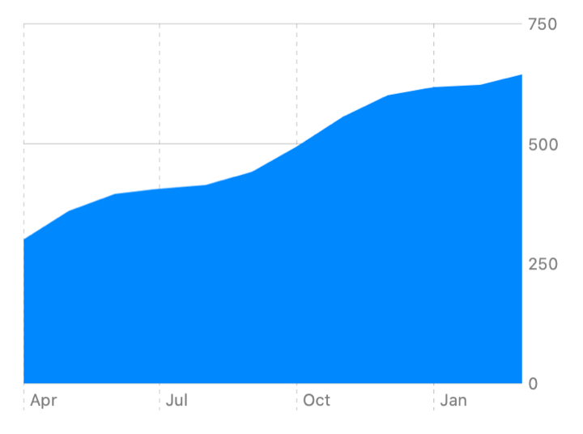
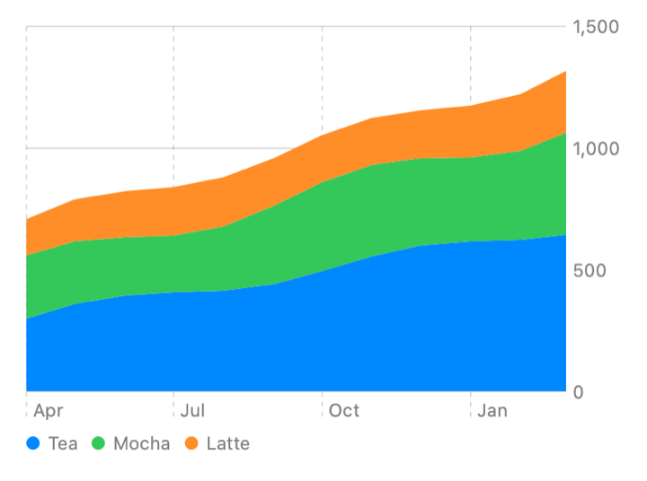
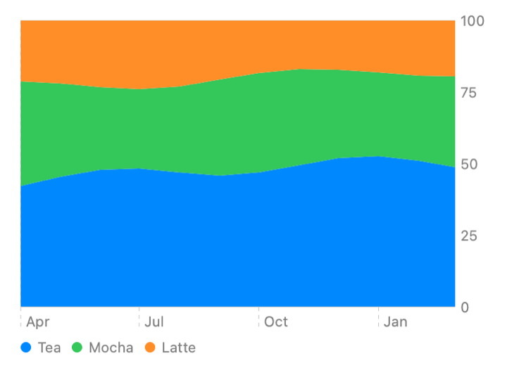
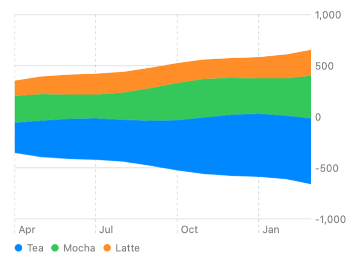
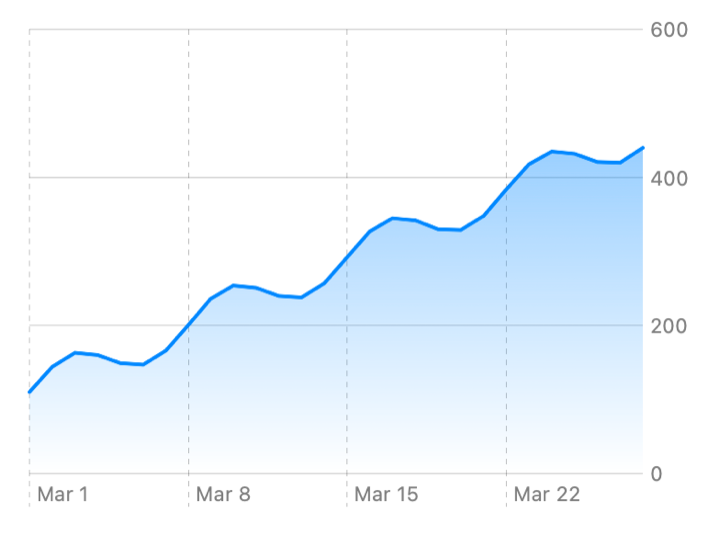
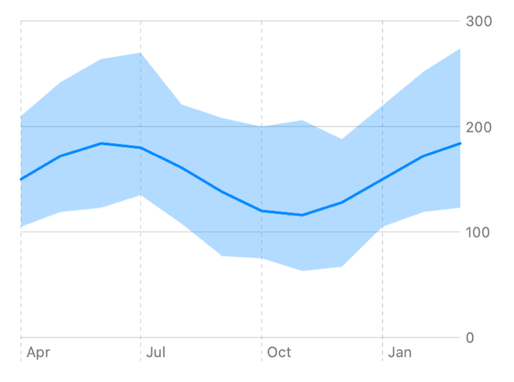

# Area chart



## Visual signature

A filled region between a line and the baseline, across a continuous horizontal axis. The top edge is the data; there is no separate outline. Several coloured bands lying on top of each other, each resting on the one below, make a stacked area chart. A filled band that floats above the baseline, wider and narrower along its length, is a range area.

Not this form if only the line is drawn (`multi-series-line.md`).

## Composition

- `AreaMark(x:y:)`, one per data point, minimum iOS 16.0. Put a date or an ordered string on x and a number on y.
- The marks join into one filled region.

<!-- snippet: Gallery/AreaChart.swift#chart -->
```swift
Chart(trend) { item in
    AreaMark(
        x: .value("Month", item.month),
        y: .value("Cups", item.cups)
    )
}
```

## Variations

**Stacked.** Add `foregroundStyle(by:)` with one row per series per x value. Each series becomes a band stacked on the previous one, with a legend. The `stacking:` parameter chooses how:



<!-- snippet: Gallery/AreaChart.swift#stacked -->
```swift
Chart(trends) { item in
    AreaMark(
        x: .value("Month", item.month),
        y: .value("Cups", item.cups),
        stacking: stacking
    )
    .foregroundStyle(by: .value("Drink", item.drink))
}
```

| `stacking:` | Looks like | Shows |
|---|---|---|
| `.standard` (default) | Bands stacked from zero; the top edge is the total | Absolute contribution of each series and the total |
| `.normalized` | Bands fill the whole plot height; the value axis runs 0 to 100 | Each series' share of the total over time |
| `.center` | Bands stacked symmetrically around a middle line; the value axis is centred on zero | A streamgraph: how the total and its mix swell and shrink |
| `.unstacked` | Every band starts at zero and they overlap | Each series against the same baseline |





**A line over a fading fill.** A `LineMark` on top of an `AreaMark` filled with a gradient, the look of a stock chart. The line carries the values; the fill adds weight.



<!-- snippet: Design/HIGPatterns.swift#line-area -->
```swift
struct LineOverGradientArea: View {
    let days: [DailySales]

    var body: some View {
        Chart(days) { day in
            AreaMark(x: .value("Day", day.day), y: .value("Cups", day.cups))
                .foregroundStyle(.linearGradient(
                    colors: [.blue.opacity(0.4), .blue.opacity(0)],
                    startPoint: .top, endPoint: .bottom
                ))
                // The fill repeats the line's data; left visible, every value is counted twice.
                .accessibilityHidden(true)
            LineMark(x: .value("Day", day.day), y: .value("Cups", day.cups))
        }
    }
}
```

An `AreaMark(x:y:)` reaches down to zero, so the scale includes zero even with `.automatic(includesZero: false)`. For a chart that should not start at zero, use the range form with a chosen `yStart`, or drop the fill. The range form's scale still includes zero by default like any number scale; add `.automatic(includesZero: false)` to bring the axis in to the band. A `unit:` on an area's date puts each point at the middle of its period, which leaves half a period of empty plot at each side; without a unit the area runs edge to edge.

**Range area.** `AreaMark(x:yStart:yEnd:)` fills between a low and a high value at each x. Pair it with a `LineMark` for the typical value. `AreaMark(xStart:xEnd:y:)` is the horizontal equivalent.



<!-- snippet: Gallery/AreaChart.swift#range -->
```swift
Chart(months) { month in
    AreaMark(
        x: .value("Month", month.month),
        yStart: .value("Lowest day", month.dailyMin),
        yEnd: .value("Highest day", month.dailyMax)
    )
    .opacity(0.3)
    LineMark(
        x: .value("Month", month.month),
        y: .value("Average day", month.dailyAverage)
    )
}
```

**Several regions without colour.** The `series:` parameter separates regions the way it separates lines, without adding a colour scale or legend.

## Accessibility

Stacked areas are read per date as the span across the bands ("varies between 300 and 150, 3 Drinks"); wrap each point's mark in a labelled `Plot`, or a stretch per plot. Where a line is drawn over an area of the same data, hide the area, as the gradient recipe does, or every value is counted twice (`../accessibility.md`).

## Pitfalls

- **Unstacked areas hide each other.** With `.unstacked`, later series are drawn over earlier ones and can cover them completely. Add `opacity` (around 0.4) so every band stays visible, or use lines.
- To draw only the line with nothing filled beneath it, use `LineMark`, not an area with a clear fill.
- Stacking order and legend order follow the same rules as bars: see `stacked-bar.md`.
- A normalized chart's axis reads 0 to 100; label it as a percentage so it is not read as a quantity.
