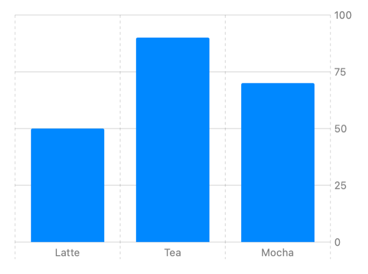
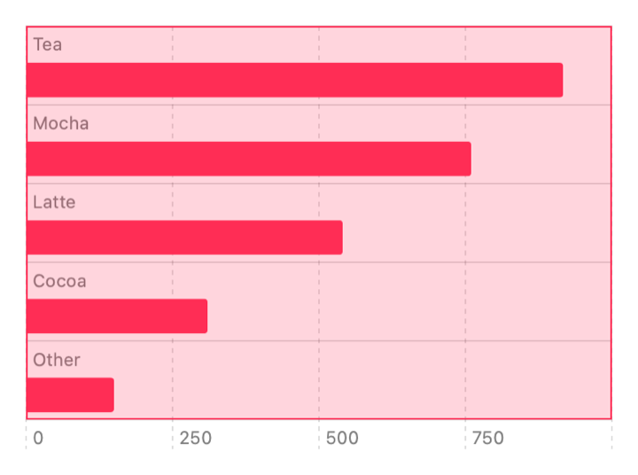
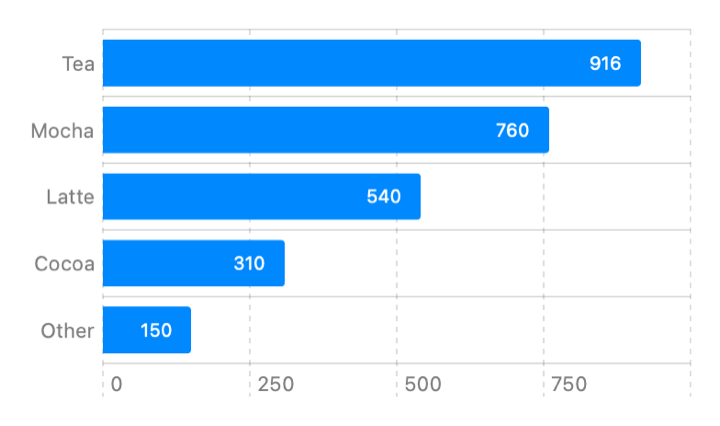
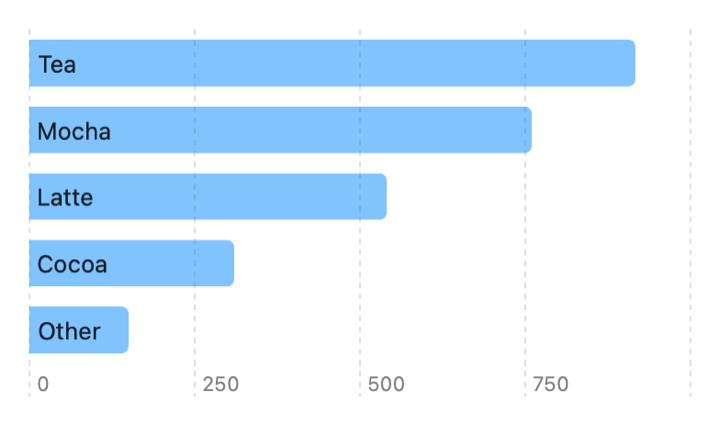

# Bar chart



## Visual signature

One solid rectangle per category, all rising from the same baseline. Category names run along the bottom and a number scale sits on the trailing edge. Every bar is the same colour and there is no legend. In the horizontal variant the bars grow from the leading edge and the category names sit just above each bar.

Not this form if the bars are split into colours (`stacked-bar.md`) or float above the baseline (`range-bar.md`).

## Composition

- `Chart(data)` with one `BarMark` per element, minimum iOS 16.0.
- A string on one axis makes it the category axis; a number on the other makes it the value axis. Swap `x` and `y` to make the bars horizontal.
- Scales, axis labels and grid lines are generated from the data.

<!-- snippet: Gallery/BarChart.swift#chart -->
```swift
Chart(sales) { item in
    BarMark(
        x: .value("Drink", item.drink),
        y: .value("Cups", item.cups)
    )
}
```

## Variations

**Horizontal bars with a styled plot area.** Use horizontal bars when category names are long or there are many categories. `chartPlotStyle` styles the plot area alone: the cup values stay outside it, while the drink names, drawn inside the plot above each bar, sit on its background.



<!-- snippet: Gallery/BarChart.swift#horizontal -->
```swift
Chart(sales) { item in
    BarMark(
        x: .value("Cups", item.cups),
        y: .value("Drink", item.drink)
    )
    .foregroundStyle(.pink)
}
.chartPlotStyle { plotArea in
    plotArea
        .background(.pink.opacity(0.2))
        .border(.pink, width: 1)
}
```

**A value on each bar.** An `annotation` at the top of each mark. Code under `annotation` in `../annotations.md`.


**The value inside the end of each bar,** with `position: .overlay` and an alignment. Code under `AnnotationPosition` in `../annotations.md`.



**The name on each bar, with no category axis.** Code under `AnnotationPosition` in `../annotations.md`.



**With a line for the average or a target:** a `RuleMark` beside the bars, labelled with an `annotation`. Use `Chart { ForEach ... }`, since a rule written inside `Chart(data)` is created once per element. Code under *Label or hide every rule* in `../accessibility.md`.

**Dates on the category axis.** Pass the date with a `unit:` so each bar takes up its day or month: see `compact.md` and `range-bar.md`.

## Pitfalls

- Bars appear in data order. Sort the data before charting if the design shows them ranked, or if its headline says which is largest.
- Vertical bars give each category name only the width of its band, and a name that does not fit is cut to an ellipsis: five bars across a phone already cut a nine-letter name ("America…"), and shorter ones at larger text sizes. Check the longest name at the narrowest width; when it does not fit, use the horizontal form.
- `Chart(data)` needs `Identifiable` elements; otherwise use `Chart(data, id: \.name)`.
