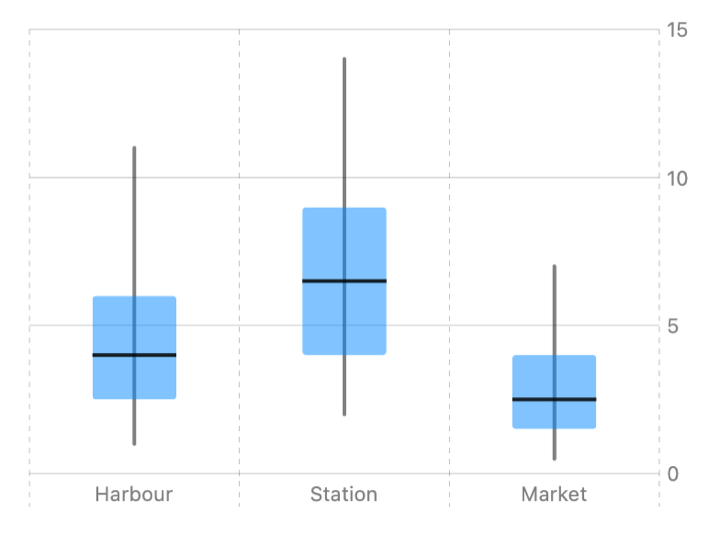

# Box plot



## Visual signature

For each category, a thin vertical line from a lowest to a highest value, a wider box over the middle part of it, and a short line across the box. It summarises how a set of values is spread: the range, the middle half, and the median. Not this form if there is only a floating bar with a tick (`range-bar.md`).

## Composition

Three marks sharing one category position, drawn in this order. Minimum iOS 16.0.

- `RuleMark(x:yStart:yEnd:)` from minimum to maximum: the whisker.
- `BarMark(x:yStart:yEnd:width:)` from the lower to the upper quartile: the box.
- `RectangleMark(x:y:width:height:)` two points high at the median, the same width as the box.

The five numbers are computed by the app; the chart only draws them.

<!-- snippet: Sessions/SessionPatterns.swift#box-plot -->
```swift
struct BoxPlotRecipe: View {
    let waits: [WaitSummary]

    var body: some View {
        Chart(waits) { wait in
            // One Plot for the three marks: one accessibility element per store.
            Plot {
                // Whisker: the full range.
                RuleMark(
                    x: .value("Store", wait.store),
                    yStart: .value("Minimum", wait.minimum),
                    yEnd: .value("Maximum", wait.maximum)
                )
                .foregroundStyle(Color.secondary)
                // Box: the middle half of the values.
                BarMark(
                    x: .value("Store", wait.store),
                    yStart: .value("Lower quartile", wait.lowerQuartile),
                    yEnd: .value("Upper quartile", wait.upperQuartile),
                    width: .ratio(0.4)
                )
                .foregroundStyle(.blue.opacity(0.5))
                // Median.
                RectangleMark(
                    x: .value("Store", wait.store),
                    y: .value("Median", wait.median),
                    width: .ratio(0.4),
                    height: .fixed(2)
                )
                .foregroundStyle(Color.primary)
            }
            .accessibilityLabel(wait.store)
            .accessibilityValue(
                // The unit is stated once, in a form that needs no agreement with the number.
                "Wait in minutes. Median \(wait.median.formatted()). Middle half \(wait.lowerQuartile.formatted()) to \(wait.upperQuartile.formatted()). Range \(wait.minimum.formatted()) to \(wait.maximum.formatted()).")
        }
    }
}
```

## Accessibility

Each category is drawn with three marks, which share one element read as the category and the whisker's range ("Harbour, 1 to 11"). The recipe puts the three marks in one `Plot` with a label and a value describing all five numbers (`../accessibility.md`, *One element per `Plot`*). In an app, format those numbers in the view's locale (`../composition.md`). For the Audio Graph, write a descriptor with the categories on x and one named series for each of the five numbers (`../audio-graph.md`). Give the chart an axis title or heading with the unit; the recipe has none.

## Pitfalls

- A box plot is a less familiar form. Say what the box and the line mean near the chart (`../design.md`).
