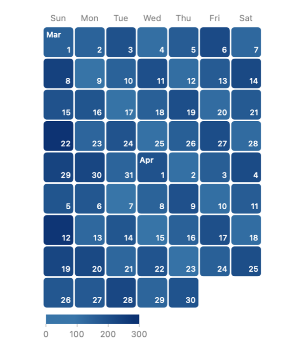

# Calendar heat map



## Visual signature

A grid seven tiles wide with one tile per day and one row per week, each tile shaded by a value, usually with the day's number in a corner and weekday names above the columns. The first and last rows are often incomplete. Not this form if the rows and columns are two unrelated categories (`heat-map.md`).

## Composition

`RectangleMark` with a date on both axes. Minimum iOS 16.0.

- **y:** the day's date with `unit: .weekOfYear`, so each week is one row. Dates on the y axis run downward, which is the order a calendar needs.
- **x:** not the day's own date, which would step every later week further to the right, but the same weekday in one reference week, with `unit: .day`. Every Monday then shares a column.
- **Size:** `width: .inset(1)` and `height: .inset(1)` take a point off each edge for an even gap. The initializer that takes start and end values has no inset.
- **Colour:** `foregroundStyle(by:)` with the day's value, and a colour range dark enough at its light end for the labels: white text needs about 4.5 to 1 against the palest tile, which the range in the code meets.
- **Labels:** `annotation(position: .overlay, ...)` puts the day number, and the month's name on its first day, inside the tile.
- **Square tiles:** the plot area's aspect ratio is seven over the number of week rows.

<!-- snippet: Gallery/CalendarHeatMap.swift#calendar -->
```swift
struct CalendarHeatMapRecipe: View {
    let days: [DailySales]
    var calendar = Calendar.current

    var body: some View {
        Chart(days) { day in
            RectangleMark(
                // Every Monday shares one x position, every Tuesday the next, and so on.
                x: .value("Weekday", columnDate(for: day.day), unit: .day, calendar: calendar),
                // The real date, as a whole week: one row per week.
                y: .value("Week", day.day, unit: .weekOfYear, calendar: calendar),
                // One point off each edge: an even two-point gap between tiles.
                width: .inset(1),
                height: .inset(1)
            )
            .foregroundStyle(by: .value("Cups", day.cups))
            .cornerRadius(4)
            .annotation(position: .overlay, alignment: .bottomTrailing, spacing: 3) {
                // Formatted to a string in the data's time zone: `Text(_:format:)` would use the device's.
                Text(day.day.formatted(Date.FormatStyle(timeZone: calendar.timeZone).day()))
                    .font(.caption2)
                    .foregroundStyle(.white)
            }
            .annotation(position: .overlay, alignment: .topLeading, spacing: 3) {
                if calendar.component(.day, from: day.day) == 1 {
                    Text(day.day.formatted(Date.FormatStyle(timeZone: calendar.timeZone).month(.abbreviated)))
                        .font(.caption2.bold())
                        .foregroundStyle(.white)
                }
            }
        }
        .chartXAxis {
            AxisMarks(position: .top, values: .stride(by: .day, calendar: calendar)) { _ in
                AxisValueLabel(format: Date.FormatStyle(timeZone: calendar.timeZone).weekday(.abbreviated), centered: true)
            }
        }
        .chartYAxis(.hidden)
        // The automatic range starts near white, where the white day numbers would vanish.
        .chartForegroundStyleScale(range: Gradient(colors: [
            Color(red: 0.22, green: 0.46, blue: 0.66), Color(red: 0.05, green: 0.2, blue: 0.45),
        ]))
        .chartPlotStyle { plotArea in
            plotArea
                // Seven columns by this many rows: square tiles at any width.
                .aspectRatio(7 / CGFloat(weeks.count), contentMode: .fit)
                // Every weekday column would otherwise be one accessibility element.
                // Replaced here, on the plot area, the new elements lie over the tiles.
                .accessibilityChildren { accessibilityGrid }
        }
    }

    /// The same weekday in the first week of the data.
    private func columnDate(for date: Date) -> Date {
        guard let firstWeek = weeks.first else { return date }
        let column = (calendar.component(.weekday, from: date) - calendar.firstWeekday + 7) % 7
        return calendar.date(byAdding: .day, value: column, to: firstWeek) ?? date
    }

    /// The start of each week the data touches, in order.
    private var weeks: [Date] {
        var starts: [Date] = []
        for day in days {
            if let start = calendar.dateInterval(of: .weekOfYear, for: day.day)?.start, starts.last != start {
                starts.append(start)
            }
        }
        return starts
    }

    /// One square per tile position, laid out as the tiles are; positions with no day are hidden.
    private var accessibilityGrid: some View {
        VStack(spacing: 0) {
            ForEach(weeks, id: \.self) { week in
                HStack(spacing: 0) {
                    ForEach(0 ..< 7, id: \.self) { column in
                        let date = calendar.date(byAdding: .day, value: column, to: week)
                        let day = days.first { calendar.isDate($0.day, inSameDayAs: date ?? .distantPast) }
                        Rectangle()
                            .accessibilityLabel((day?.day ?? .now).formatted(Date.FormatStyle(timeZone: calendar.timeZone).weekday(.wide).day().month(.wide)))
                            .accessibilityValue(Text("^[\(day?.cups ?? 0) cup](inflect: true)"))
                            // Headings let VoiceOver jump from month to month.
                            .accessibilityAddTraits(
                                day.map { calendar.component(.day, from: $0.day) } == 1 ? .isHeader : [])
                            .accessibilityHidden(day == nil)
                    }
                }
            }
        }
    }
}
```

Pass the calendar the app uses; its first weekday decides which day is the first column.

## Accessibility

Without help every weekday column is one element summarising all its days. The recipe replaces the plot area's elements with a grid of squares laid out like the tiles, one per day, labelled with the full date and the value, and marks each first of the month as a heading (`../accessibility.md`, *When the elements should not follow the marks*). Without the headings, a labelled `Plot` around each tile does the same job in less code.

This form gets no automatic Audio Graph. Attach a chart descriptor of the daily values (`../audio-graph.md`).

## Pitfalls

- Using the day's own date for x: the weeks form a staircase.
- Hiding the legend without saying anywhere what the shading measures.
- White labels over the automatic colour range, which starts almost white.
