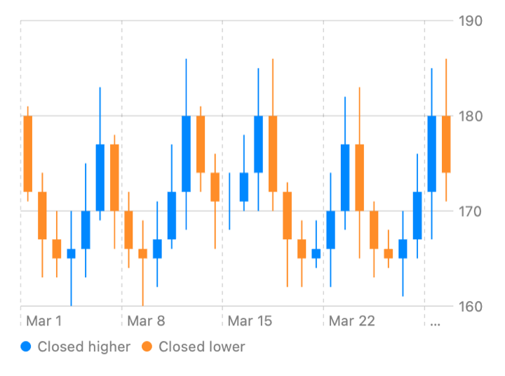

# Candlestick chart



## Visual signature

Along a time axis, one thin vertical line per period with a wider box over part of it, the boxes in two colours. The line spans the lowest to the highest price; the box spans the opening to the closing price, and its colour says whether the price rose or fell. Not this form if every box sits at the same place on its line and has a line across it (`box-plot.md`), or if there is a box with no line (`range-bar.md`).

## Composition

Swift Charts has no candlestick mark. Build one from two marks sharing an x value, and make it a `ChartContent` type so every chart in the app draws candles the same way (`../composition.md`). Minimum iOS 16.0.

- `RuleMark(x:yStart:yEnd:)` from low to high: the wick.
- `RectangleMark(x:yStart:yEnd:width:)` from open to close: the body.

The type takes `PlottableValue`s, as the framework's marks do, so it is called with the same `.value("Label", value)` syntax and works for any plottable x and y:

<!-- snippet: Gallery/CandlestickChart.swift#candlestick-mark -->
```swift
/// One candle: a thin wick from low to high and a wider body from open to close.
/// A custom mark built from two of the framework's, taking plottable values as they do.
struct CandlestickMark<X: Plottable, Y: Plottable>: ChartContent {
    let x: PlottableValue<X>
    let low: PlottableValue<Y>
    let high: PlottableValue<Y>
    let open: PlottableValue<Y>
    let close: PlottableValue<Y>

    var body: some ChartContent {
        // The Plot makes the two marks one unit, so a label given to a candle describes the whole candle.
        Plot {
            // A clear band the full height of the plot, so VoiceOver reads the candles along x and not
            // highest wick first. Clear is the only style the type sets; opacity(0) does not do it.
            RectangleMark(x: x, width: .ratio(0.6))
                .foregroundStyle(.clear)
            RuleMark(x: x, yStart: low, yEnd: high)
                .lineStyle(StrokeStyle(lineWidth: 1))
            RectangleMark(x: x, yStart: open, yEnd: close, width: .ratio(0.6))
        }
    }
}
```

<!-- snippet: Gallery/CandlestickChart.swift#candlestick -->
```swift
struct CandlestickChartRecipe: View {
    let prices: [DailyPrice]

    /// The lows and highs widened to the next 10 dollars each way: the drawn axis and the descriptor share it.
    private var priceAxis: ClosedRange<Double> {
        let lower = ((prices.map(\.low).min() ?? 0) / 10).rounded(.down) * 10
        return lower ... max(lower + 10, ((prices.map(\.high).max() ?? 0) / 10).rounded(.up) * 10)
    }

    var body: some View {
        Chart(prices) { price in
            CandlestickMark(
                x: .value("Day", price.day, unit: .day),
                low: .value("Low", price.low),
                high: .value("High", price.high),
                open: .value("Open", price.open),
                close: .value("Close", price.close)
            )
            // Styled from outside, like a built-in mark: the mark sets no colour of its own.
            // Direction is encoded, so the legend names it; the scale below picks the colours.
            .foregroundStyle(by: .value("Direction", price.close >= price.open ? "Closed higher" : "Closed lower"))
            .accessibilityLabel(price.day.formatted(.dateTime.weekday(.wide).month(.wide).day()))
            .accessibilityValue(
                "Open \(price.open.formatted()), close \(price.close.formatted()), low \(price.low.formatted()), high \(price.high.formatted())"
            )
        }
        // Blue and orange, not green and red, which carry no meaning in some cultures.
        .chartForegroundStyleScale(["Closed higher": Color.blue, "Closed lower": Color.orange])
        // Prices sit far from zero; without a domain that leaves zero out the candles are squashed at the top.
        .chartYScale(domain: priceAxis)
        // A candlestick has no Audio Graph of its own (read on iOS): give it one.
        .accessibilityChartDescriptor(CandleDescriptor(prices: prices, priceAxis: priceAxis))
    }
}

struct CandleDescriptor: AXChartDescriptorRepresentable {
    let prices: [DailyPrice]
    /// The value axis as drawn, set on the chart with `chartYScale(domain:)`.
    let priceAxis: ClosedRange<Double>

    func makeChartDescriptor() -> AXChartDescriptor {
        let days = prices.map { $0.day.formatted(.dateTime.month(.wide).day()) }
        let lows = prices.map(\.low), highs = prices.map(\.high)
        // One series per number at each position, over separate days: not continuous.
        func series(_ name: String, _ values: [Double]) -> AXDataSeriesDescriptor {
            AXDataSeriesDescriptor(name: name, isContinuous: false,
                                   dataPoints: zip(days, values).map { AXDataPoint(x: $0, y: $1) })
        }
        return AXChartDescriptor(
            title: "Coffee futures, daily price",
            summary: "\(prices.count) days. Lowest \((lows.min() ?? 0).formatted()), highest \((highs.max() ?? 0).formatted()), in dollars a pound.",
            xAxis: AXCategoricalDataAxisDescriptor(title: "Day", categoryOrder: days),
            yAxis: AXNumericDataAxisDescriptor(
                title: "Price, dollars a pound",
                range: priceAxis,
                gridlinePositions: []
            ) { "\($0.formatted()) dollars" },
            additionalAxes: [],
            series: [series("Open", prices.map(\.open)), series("Close", prices.map(\.close)),
                     series("Low", lows), series("High", highs)]
        )
    }
}
```

## Variations

- **Volume underneath:** a second chart of bars sharing the x domain (`linked-charts.md`).
- **A fixed body width in points:** `width: .fixed(6)`; `.ratio` keeps the bodies from touching as the number of days changes.

## Accessibility

The custom mark wraps its wick and body in a `Plot`, so the label and value the recipe gives each candle make it one element covering both. Without the plot the label is unreliable.

Rise and fall are encoded as a value, so the legend names them, but they are still told apart by colour alone on the chart. Add a second difference where the design allows it, such as a small arrow annotation above each candle; an outlined body would need a style set inside the mark (`../design.md`, *Colour*). A candlestick gets no automatic Audio Graph; the recipe's descriptor (`../audio-graph.md`) gives the four prices as four series, not continuous, over the drawn range: the lows and highs widened to a round step, one domain passed to the chart and the descriptor.

## Pitfalls

- Setting the candle's colour inside the custom mark. A style set on a mark inside a `ChartContent` type wins over one applied to the type from outside, so the caller could not colour by direction, and the legend no longer describes what is drawn: it can stay, naming colours the candles no longer have, or disappear. Leave unset whatever the caller should control.
- Leaving the price scale to start at zero, which presses every candle against the top of the plot.
