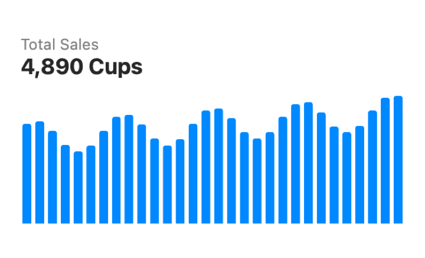

# Compact overview chart



## Visual signature

A small chart, about 100 points tall, with no axis labels, grid lines or legend. It sits directly under a short caption and a large headline figure, typically in a list row or card that opens a detail screen. The chart shows the shape of the data; the text states the takeaway.

A card with a headline and a full chart, as in the Health app, is the same idea at detail size: caption, figure with unit, period, then a chart with its axes. Code and image under *Descriptions* in `../design.md`.

## Composition

- Any mark; bars, lines and donuts are all used this way. Minimum iOS 16.0.
- `chartXAxis(.hidden)` and `chartYAxis(.hidden)` remove both axes. Add `chartLegend(.hidden)` when the marks use a `by:` encoding.
- A fixed `frame(height:)`.
- The headline text carries what the missing axes would have: the number and its unit.

<!-- snippet: Gallery/CompactChart.swift#chart -->
```swift
VStack(alignment: .leading) {
    Text("Total Sales")
        .font(.callout)
        .foregroundStyle(.secondary)
    Text("\(days.map(\.cups).reduce(0, +), format: .number) Cups")
        .font(.title2.bold())
    Chart(days) { item in
        BarMark(
            x: .value("Day", item.day, unit: .day),
            y: .value("Cups", item.cups)
        )
    }
    .chartXAxis(.hidden)
    .chartYAxis(.hidden)
    .frame(height: 100)
}
```

## Variations

- **Compact line chart with day initials.** Keep a minimal x axis and hide the rest: the styled variation in `multi-series-line.md`.
- **Compact donut.** A `SectorMark` chart with the legend hidden and one sector at full opacity: `donut.md`.

## Accessibility

A compact chart that opens a fuller one is a single element with a succinct label and value, not a chart to explore (`../accessibility.md`, *Decide what an element is*).

## Pitfalls

- Hiding the axes removes the only place values were readable. Always pair the chart with text that states the figure.
- The compact chart and its detail chart should plot the same data the same way, so the detail reads as a closer look at the same thing.
