# Chart with customised axes

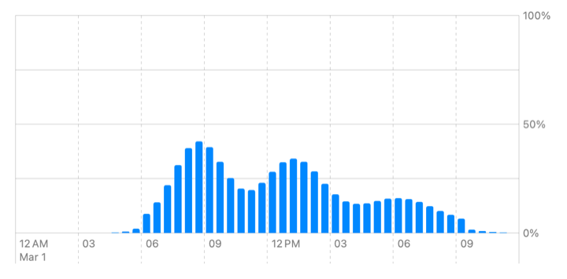

## Visual signature

Signs that an axis has been customised, each of which is one change from the defaults in `README.md`:

- The value axis runs to a round maximum well above the data (0 to 100 for a percentage).
- Fewer labels than grid lines, or grid lines with no label.
- Labels with a unit or symbol: `50%`, `$20`, `3 km`.
- A value axis on the leading edge, or a category axis along the top.
- Time labels more frequent than the default, abbreviated, or with a second line (a date under an hour).
- One grid line drawn differently from the rest: solid among dashed, or heavier.
- Category names outside the plot on the left of horizontal bars.

The same data with nothing customised, for comparison:

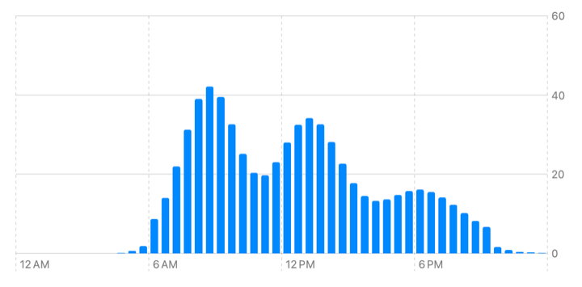

## Composition

Minimum iOS 16.0. Each step is independent; apply only those the design shows.

1. **Fix the domain** so the data is seen against its full possible range: `chartYScale(domain: 0 ... 100)` (`../scales.md`).
2. **Choose the values, format the labels, and add unlabelled grid lines** with two `AxisMarks`:

<!-- snippet: Axes/AxisRecipes.swift#compose -->
```swift
func percentAxisWithMinorGridLines() -> some View {
    chartYAxis {
        AxisMarks(values: [0, 50, 100]) {
            AxisValueLabel(format: Decimal.FormatStyle.Percent.percent.scale(1))
        }
        AxisMarks(values: [0, 25, 50, 75, 100]) {
            AxisGridLine()
        }
    }
}
```

3. **Mark the time axis at a chosen interval and vary the labels by value:**

<!-- snippet: Axes/AxisRecipes.swift#conditional -->
```swift
/// `calendar` is the one the dates were made in, and `locale` the view's (`data.md`).
func hourAxis(every hours: Int = 3, calendar: Calendar, locale: Locale) -> some View {
    let format = Date.FormatStyle(locale: locale, timeZone: calendar.timeZone)
    return chartXAxis {
        AxisMarks(values: .stride(by: .hour, count: hours, calendar: calendar)) { value in
            if let date = value.as(Date.self) {
                let hour = calendar.component(.hour, from: date)
                AxisValueLabel {
                    VStack(alignment: .leading) {
                        // AM or PM only where it changes. Formatted to a string first:
                        // `Text(date, format:)` would use the device's time zone.
                        if hour == 0 || hour == 12 {
                            Text(date.formatted(format.hour()))
                        } else {
                            Text(date.formatted(format.hour(.defaultDigits(amPM: .omitted))))
                        }
                        // The date under the first label and at each midnight.
                        if value.index == 0 || hour == 0 {
                            Text(date.formatted(format.month().day()))
                        }
                    }
                }
                if hour == 0 {
                    // A solid line at the day boundary; the default is dashed.
                    AxisGridLine(stroke: StrokeStyle(lineWidth: 0.5))
                    AxisTick(stroke: StrokeStyle(lineWidth: 0.5))
                } else {
                    AxisGridLine()
                    AxisTick()
                }
            }
        }
    }
}
```

## Variations

**A logarithmic axis:** labels at powers of ten, evenly spaced (`../scales.md`).

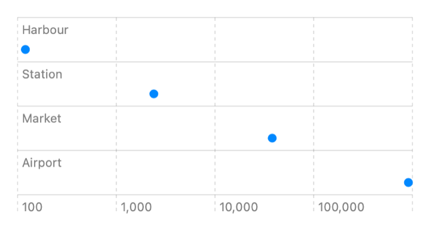

**Axes that do not start at zero:** both scales fitted to the data.

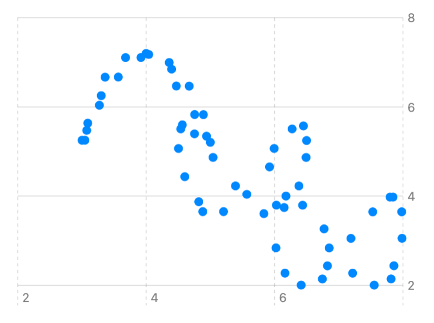

**Label placement presets.** `AxisMarks(preset:)` moves labels relative to their grid lines:

| `.aligned` | `.extended` | `.inset` |
|---|---|---|
| 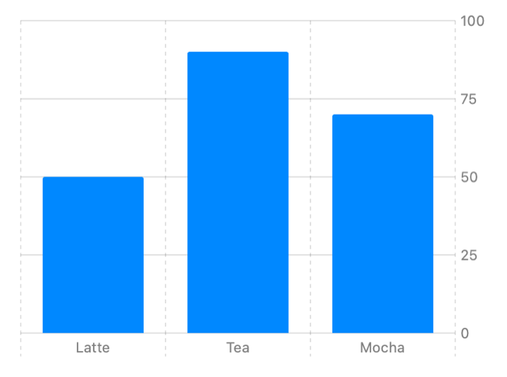 | 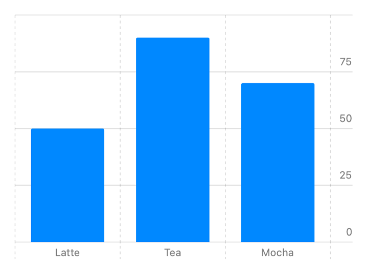 | 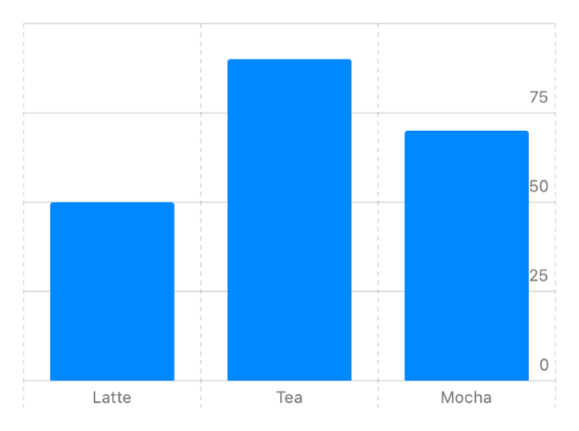 |

**Value axis on the leading edge:** `AxisMarks(position: .leading)`.

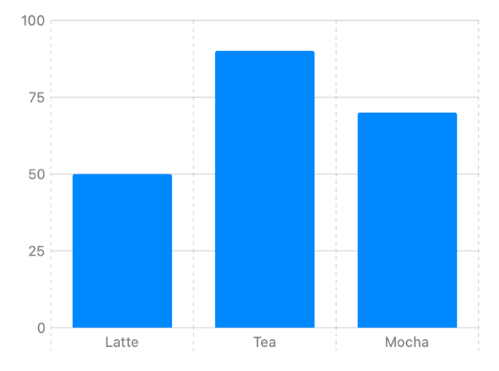

**Styled parts:** orange dashed grid lines, longer ticks, bold vertical category labels. Code under *Styling axis marks and whole axes* in `../axes.md`.

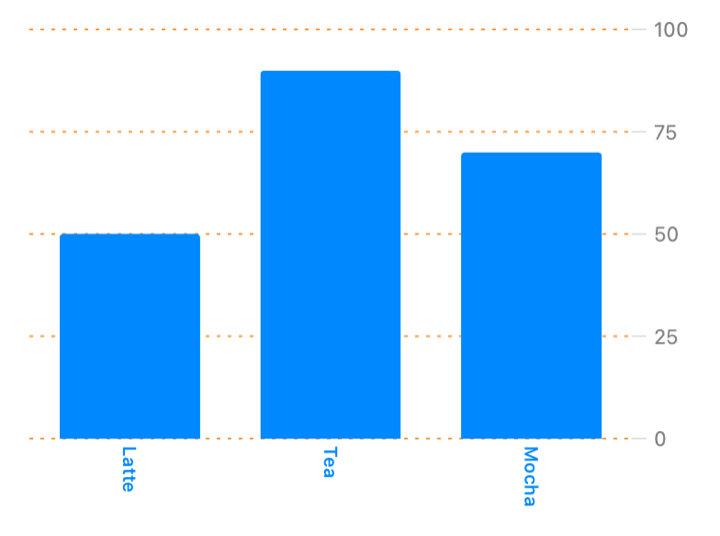

**Grid lines at every month, labels only at each quarter:** decide per value inside one `AxisMarks`.

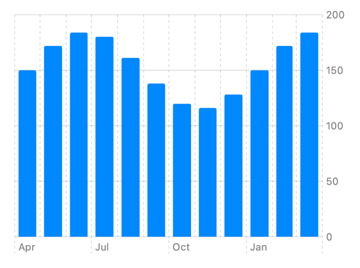

<!-- snippet: Sessions/SessionPatterns.swift#quarters -->
```swift
extension View {
    /// A grid line every month, with a tick and a label only where a quarter starts.
    func quarterAxis(calendar: Calendar) -> some View {
        chartXAxis {
            AxisMarks(values: .stride(by: .month)) { value in
                AxisGridLine()
                if let date = value.as(Date.self), calendar.component(.month, from: date) % 3 == 1 {
                    AxisTick()
                    AxisValueLabel(format: .dateTime.month(.abbreviated))
                }
            }
        }
    }
}
```

**Only the first and last dates labelled,** to say which period the chart covers without a full axis:

<!-- snippet: Sessions/SessionPatterns.swift#end-labels -->
```swift
extension View {
    /// Only the first and last dates are labelled: enough to say which period the chart covers.
    func labelledAtEnds(first: Date, last: Date) -> some View {
        chartXAxis {
            AxisMarks(values: [first, last]) { _ in
                AxisValueLabel(format: .dateTime.month().day())
            }
        }
    }
}
```

A label at the very end of the scale can be cut off at the chart's edge; leave room for it.

**Axis titles with units:** `chartXAxisLabel` and `chartYAxisLabel` (`../axes.md`).

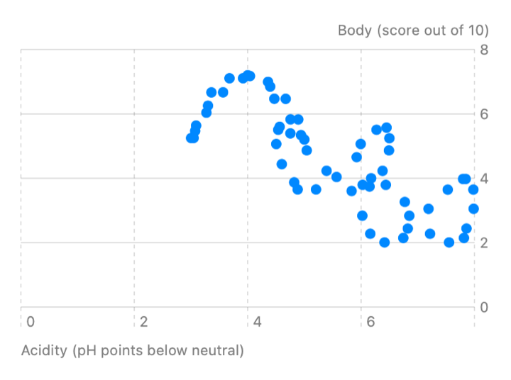

**Quiet axes for an interactive chart:** three values, pale grid lines and labels, so the data stays prominent. Code under *Axes* in `../design.md`.

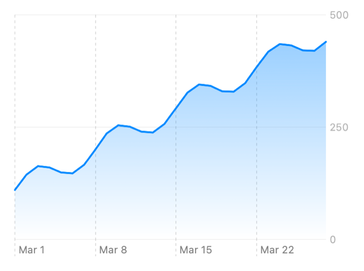

**One letter per day, centred under each bar:**

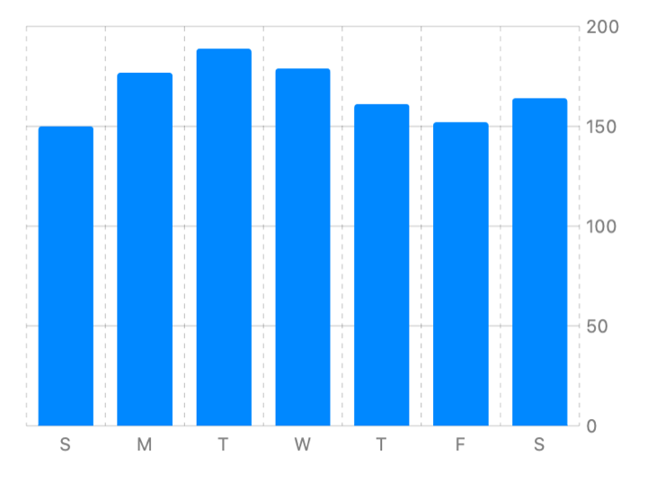

## Pitfalls

- At phone width the two-line labels every three hours are truncated to "12…"; pass a six-hour stride there.
- With AM and PM omitted, the hour is drawn with two digits ("03", "09"). That is the format's output, not a further customisation.
- All of `../axes.md`'s pitfalls apply.
