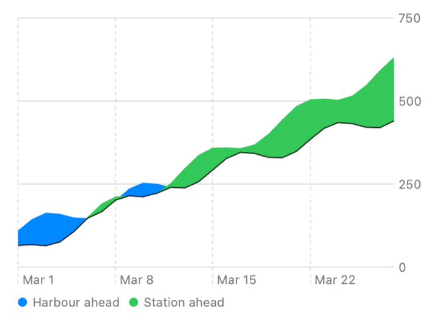

# Difference chart



## Visual signature

Two series over time shown as the gap between them: a filled region between the two lines whose colour changes each time the lead changes, usually with a thin line along the lower of the two. It answers "who is ahead, by how much, and when did that change". Not this form if the fill is one colour throughout (`area.md`, range area).

## Composition

Two `AreaMark(x:yStart:yEnd:series:)` layers and a `LineMark`. Minimum iOS 16.0.

- Each area runs from the lower of the two values up to its own series' value. Where that series is behind, start and end are equal and nothing is drawn, so each colour appears only where its series leads.
- `series:` keeps the two areas apart, and `foregroundStyle(by:)` gives them colours and a legend.
- The line follows the lower value, the base of whichever region is showing.
- Both series must be sampled at the same x values.
- "Nothing is drawn" holds only at the samples. Between a sample where a series leads and the next where it trails, its area tapers to the other series' value, not to the crossing, so the two fills overlap in a wedge past the point where the lines cross. A single line along the lower value, as here, hides it. To draw both series' own lines, add a point to the data wherever the lead changes, at the interpolated x where the two values are equal.

<!-- snippet: Community/CommunityPatterns.swift#difference -->
```swift
struct DifferenceChartRecipe: View {
    /// Two series sampled on the same days.
    let harbour: [DailySales]
    let station: [DailySales]

    private var days: [(day: Date, harbour: Int, station: Int)] {
        zip(harbour, station).map { (day: $0.day, harbour: $0.cups, station: $1.cups) }
    }

    var body: some View {
        Chart {
            ForEach(days, id: \.day) { item in
                // Filled only where Harbour is ahead: from the lower value up to Harbour's.
                AreaMark(
                    x: .value("Day", item.day),
                    yStart: .value("Cups", min(item.harbour, item.station)),
                    yEnd: .value("Cups", item.harbour),
                    series: .value("Lead", "Harbour ahead")
                )
                .foregroundStyle(by: .value("Lead", "Harbour ahead"))
                .accessibilityHidden(true)
                // And only where Station is ahead.
                AreaMark(
                    x: .value("Day", item.day),
                    yStart: .value("Cups", min(item.harbour, item.station)),
                    yEnd: .value("Cups", item.station),
                    series: .value("Lead", "Station ahead")
                )
                .foregroundStyle(by: .value("Lead", "Station ahead"))
                // The fills draw the gap. Neither is read out: the chart descriptor carries both series.
                .accessibilityHidden(true)
            }
            ForEach(days, id: \.day) { item in
                LineMark(
                    x: .value("Day", item.day),
                    y: .value("Cups", min(item.harbour, item.station)),
                    series: .value("Line", "Lower of the two")
                )
                .foregroundStyle(Color.primary)
                .lineStyle(StrokeStyle(lineWidth: 1))
                .accessibilityHidden(true)
            }
        }
        .chartYScale(domain: .automatic(includesZero: false))
        .accessibilityChartDescriptor(TwoStoreDescriptor(harbour: harbour, station: station))
    }
}

/// With every layer hidden, assistive technologies get the two series themselves.
struct TwoStoreDescriptor: AXChartDescriptorRepresentable {
    let harbour: [DailySales]
    let station: [DailySales]

    func makeChartDescriptor() -> AXChartDescriptor {
        let dates = harbour.map { $0.day.formatted(.dateTime.month(.wide).day()) }
        func series(_ name: String, _ days: [DailySales]) -> AXDataSeriesDescriptor {
            AXDataSeriesDescriptor(
                name: name, isContinuous: true,
                dataPoints: zip(dates, days).map { AXDataPoint(x: $0, y: Double($1.cups)) })
        }
        let cups = (harbour + station).map { Double($0.cups) }
        // The drawn scale leaves out zero, so the range starts at the lowest value.
        let range = (cups.min() ?? 0) ... (cups.max() ?? 0)
        return AXChartDescriptor(
            title: "Daily cups sold, Harbour and Station",
            summary: "\(dates.count) days. Harbour ahead on \(zip(harbour, station).filter { $0.cups > $1.cups }.count) of them.",
            xAxis: AXCategoricalDataAxisDescriptor(title: "Day", categoryOrder: dates),
            yAxis: AXNumericDataAxisDescriptor(title: "Cups sold", range: range, gridlinePositions: []) {
                $0.isFinite ? spokenCups(Int($0.rounded())) : ""
            },
            additionalAxes: [],
            series: [series("Harbour", harbour), series("Station", station)]
        )
    }
}
```

## Accessibility

Three layers share every date, and none says what the chart is about. The recipe hides all three and gives assistive technologies the two series themselves through a chart descriptor (`../audio-graph.md`).

## Pitfalls

- Smoothing the areas and the line with different interpolation methods: their edges no longer meet.
- Two series on different dates. Resample them to shared dates first.
