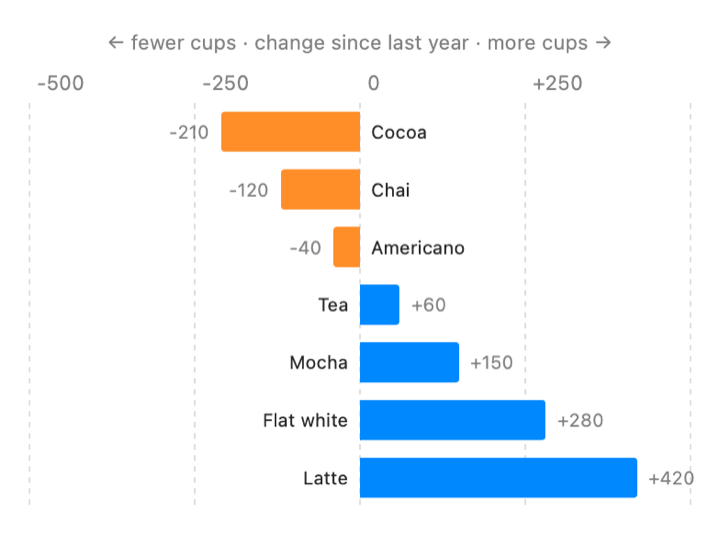

# Diverging bar chart



## Visual signature

Horizontal bars that grow left or right from one zero line, each a single signed value, usually sorted so the bars form a sweep from the most negative to the most positive. Names sit beside the bars, on the side each bar leaves empty, and the value axis runs along the top with signed labels. Not this form if every row has a bar on both sides (`population-pyramid.md`), or if the positive and negative parts stack in one bar (`stacked-bar.md`).

## Composition

`BarMark` with the signed value on x and the category on y; a bar grows from zero toward its value, in either direction. Minimum iOS 16.0.

- Two `annotation`s per bar, their positions chosen by the value's sign: the name at the base, the signed value beyond the end.
- The y axis hidden, since the annotations name the rows where the eye already is.
- The x axis on top, labels formatted with an explicit sign, and an axis label saying what each direction means.
- Sort the data; the chart keeps data order.

<!-- snippet: Community/CommunityPatterns.swift#diverging -->
```swift
struct DivergingBarRecipe: View {
    /// Sorted by change, so the bars form one sweep from the largest fall to the largest rise.
    let changes: [DrinkChange]

    var body: some View {
        Chart(changes) { item in
            BarMark(
                x: .value("Change in cups", item.change),
                y: .value("Drink", item.drink)
            )
            // Direction is shown by side and by sign, so colour is a second cue, not the only one.
            .foregroundStyle(item.change >= 0 ? Color.blue : Color.orange)
            // The name sits at the bar's base, on the side the bar does not occupy.
            .annotation(position: item.change >= 0 ? .leading : .trailing, alignment: .center, spacing: 6) {
                Text(item.drink).font(.caption)
            }
            // The signed value sits beyond the bar's end.
            .annotation(position: item.change >= 0 ? .trailing : .leading, alignment: .center, spacing: 6) {
                Text(item.change, format: .number.sign(strategy: .always(includingZero: false)))
                    .font(.caption)
                    .foregroundStyle(Color.secondary)
            }
        }
        // Names are annotations beside each bar; a y axis would repeat them far from the bars.
        .chartYAxis(.hidden)
        .chartXAxis {
            AxisMarks(position: .top) {
                AxisGridLine()
                AxisValueLabel(format: IntegerFormatStyle<Int>.number.sign(strategy: .always(includingZero: false)))
            }
        }
        .chartXAxisLabel("← fewer cups · change since last year · more cups →", position: .top, alignment: .center)
    }
}
```

## Accessibility

One bar per row, so each is its own element, read as the name and the signed number. Wrap each bar in a labelled `Plot` to add the unit and to say "fewer" or "more" in words (`../accessibility.md`).

## Pitfalls

- Colour as the only sign of direction. Here side and sign already carry it, which is why the recipe may pick each bar's colour in code and needs no legend: the axis title names the two sides.
- The axis title's arrows point the wrong way in a right-to-left layout, where the chart mirrors and the title's text does not. Swap the title's two phrases when `layoutDirection` is right-to-left; the arrows stay where they are.
- An axis title wider than the chart is cut off at both ends, not wrapped; at the accessibility text sizes break it over two lines yourself. Check the names and numbers beside the bars at those sizes too.
- Leaving the y axis visible: the names are then far from the short bars they belong to.
