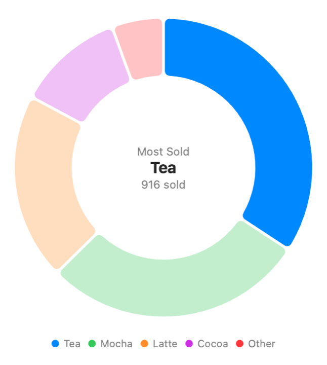

# Donut or pie chart



## Visual signature

A ring cut into coloured wedges, each wedge's angle proportional to its value. Small gaps between wedges and slightly rounded wedge corners are common. Text in the hole names one wedge and its value; that wedge is at full colour while the others are faded. With no hole it is a pie chart.

## Composition

Minimum iOS 17.0 for everything here.

- `SectorMark(angle:innerRadius:angularInset:)`. `innerRadius: .ratio(0.618)` makes the hole; leave it out for a pie. `angularInset` is the gap between sectors.
- `cornerRadius` rounds the sector corners; `foregroundStyle(by:)` colours them and makes the legend.
- `opacity` on each sector, full for the highlighted one, to focus attention.
- `chartAngleSelection(value:)` for touching and holding, or dragging, over sectors. The selection ends when the finger lifts (`../interaction.md`).
- `chartBackground` with `ChartProxy.plotFrame` to centre a SwiftUI view in the hole.

<!-- snippet: Gallery/DonutChart.swift#chart -->
```swift
@available(iOS 17.0, macOS 14.0, tvOS 17.0, watchOS 10.0, *)
struct DonutChartRecipe: View {
    /// Largest first, so the sectors read clockwise from the biggest.
    let shares: [DrinkSales]
    @State var selectedCups: Double?

    /// `chartAngleSelection` reports a position along the summed values, not an element.
    /// Find which element's running range contains it.
    private var selected: DrinkSales? {
        guard let selectedCups else { return nil }
        var runningTotal = 0.0
        for share in shares {
            runningTotal += Double(share.cups)
            if selectedCups < runningTotal { return share }
        }
        return nil
    }

    private var highlighted: DrinkSales? { selected ?? shares.first }

    var body: some View {
        Chart(shares) { share in
            SectorMark(
                angle: .value("Cups", share.cups),
                innerRadius: .ratio(0.618),
                angularInset: 1.5
            )
            .cornerRadius(5)
            .foregroundStyle(by: .value("Drink", share.drink))
            .opacity(share.id == highlighted?.id ? 1 : 0.3)
        }
        .chartLegend(alignment: .center, spacing: 18)
        .chartAngleSelection(value: $selectedCups)
        .chartBackground { proxy in
            GeometryReader { geometry in
                if let anchor = proxy.plotFrame, let highlighted {
                    let frame = geometry[anchor]
                    VStack {
                        Text(selected == nil ? "Most Sold" : "Selected")
                            .font(.callout)
                            .foregroundStyle(.secondary)
                        Text(highlighted.drink)
                            .font(.title2.bold())
                        Text("\(highlighted.cups, format: .number) sold")
                            .font(.callout)
                            .foregroundStyle(.secondary)
                    }
                    .position(x: frame.midX, y: frame.midY)
                }
            }
        }
    }
}
```

## Variations

- **Pie:** omit `innerRadius`.
- **Compact:** hide the legend, drop the selection and centre text, and set a small frame height.
- **Legend:** `chartLegend(alignment: .center, spacing: 18)` centres it under the ring; `chartLegend(.hidden)` removes it when the centre text or direct labels identify the sectors.

## Accessibility

Each sector is its own element, read as its category and value ("Tea, 916"); give it a label and value to add the unit or the share. VoiceOver reads the sectors in the order of their place on screen, top to bottom, not clockwise from 12 o'clock: in a five-sector donut ordered largest first, the smallest sector, which ends at 12 o'clock, is read first. Text placed in the hole with `chartBackground` is not read, so nothing may be said only there. A pie or donut has no automatic Audio Graph: write a chart descriptor with the sectors as categories (`../accessibility.md`, `../audio-graph.md`).

## Pitfalls

- **`chartAngleSelection` does not report which sector was touched.** It reports a value along the running total of all the angle values. Convert it by finding the element whose cumulative range contains it, as the recipe does.
- **`plotFrame` is optional.** Unwrap it; do not force it.
- **Keep sector order stable.** If the same categories are shown for different periods, keep them in one fixed order across periods; re-sorting per period makes sectors jump position when the data changes.
- Sort largest first for a single data set, so the biggest sector starts at 12 o'clock.
- On an iOS 16 deployment target this whole chart is gated: see `../availability/README.md` for the pattern and offer a bar chart as the fallback.
