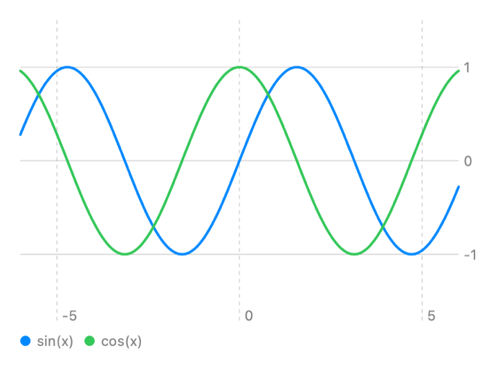
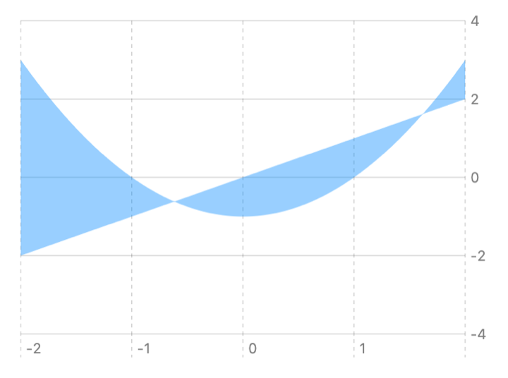
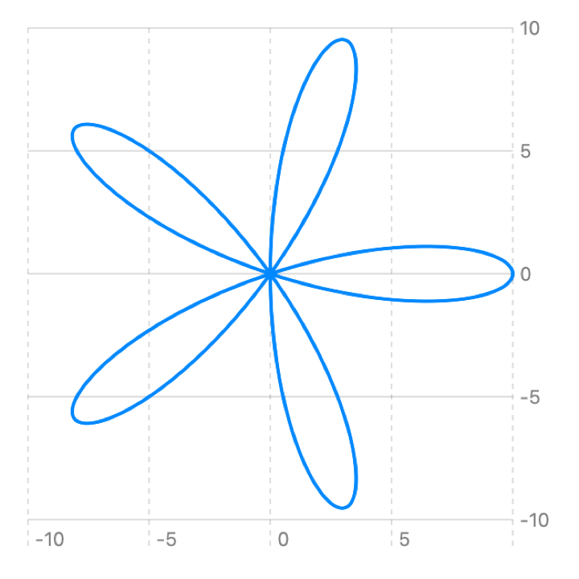
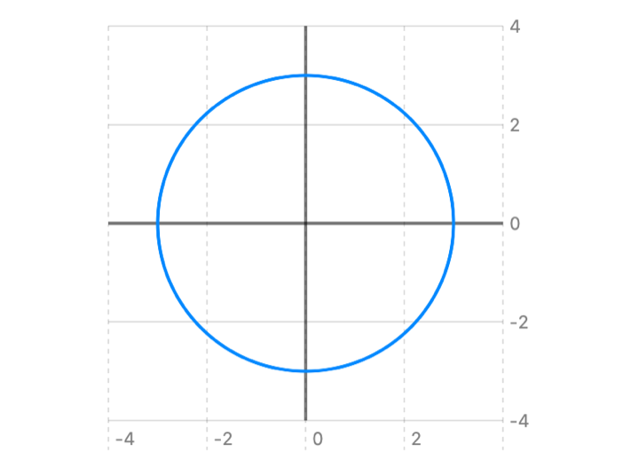
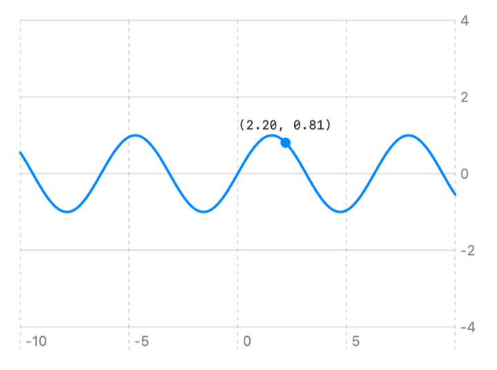

# Function plot



## Visual signature

A perfectly smooth mathematical curve with no visible data points, usually on axes centred on zero with negative and positive values on both. It may be a wave, a parabola, a filled region between two curves, or a closed looping figure.

## Composition

- `LinePlot(x:y:function:)`, minimum iOS 18.0. There is no equivalent on earlier releases short of sampling the function into data for `LineMark`.
- `chartXScale(domain:)` and `chartYScale(domain:)` choose the window onto the function.
- `foregroundStyle(by:)` with a constant value names each curve in the legend.

<!-- snippet: Plots/FunctionPlots.swift#line -->
```swift
@available(iOS 18.0, macOS 15.0, tvOS 18.0, watchOS 11.0, visionOS 2.0, *)
struct FunctionPlotRecipe: View {
    var body: some View {
        Chart {
            LinePlot(x: "x", y: "sin(x)") { x in sin(x) }
                .foregroundStyle(by: .value("Function", "sin(x)"))
            LinePlot(x: "x", y: "cos(x)") { x in cos(x) }
                .foregroundStyle(by: .value("Function", "cos(x)"))
        }
        .chartXScale(domain: -6 ... 6)
        .chartYScale(domain: -1.5 ... 1.5)
    }
}
```

## Variations

**Area between two functions:** `AreaPlot(x:yStart:yEnd:function:)`.



**Parametric curve:** `LinePlot(x:y:t:domain:function:)`, where the closure returns both coordinates.



<!-- snippet: Plots/FunctionPlots.swift#parametric -->
```swift
@available(iOS 18.0, macOS 15.0, tvOS 18.0, watchOS 11.0, visionOS 2.0, *)
struct ParametricPlot: View {
    var body: some View {
        Chart {
            LinePlot(x: "x", y: "y", t: "t", domain: 0 ... 2 * .pi) { t in
                (x: 10 * cos(5 * t) * cos(t), y: 10 * cos(5 * t) * sin(t))
            }
        }
        .chartXScale(domain: -10 ... 10)
        .chartYScale(domain: -10 ... 10)
    }
}
```

**True proportions and axes through the origin.** An `aspectRatio` on the plot area makes one unit the same length on both axes; two `RuleMark`s at zero draw the axes mathematicians expect.



<!-- snippet: Dashboard/DashboardPlots.swift#square-plot -->
```swift
@available(iOS 18.0, macOS 15.0, tvOS 18.0, watchOS 11.0, visionOS 2.0, *)
struct SquareFunctionPlot: View {
    var body: some View {
        Chart {
            // Axis lines through the origin.
            RuleMark(x: .value("y axis", 0)).foregroundStyle(Color.secondary)
            RuleMark(y: .value("x axis", 0)).foregroundStyle(Color.secondary)

            LinePlot(x: "x", y: "y", t: "t", domain: 0 ... 2 * .pi) { t in
                (x: 3 * cos(t), y: 3 * sin(t))
            }
        }
        .chartXScale(domain: -4 ... 4)
        .chartYScale(domain: -4 ... 4)
        .chartPlotStyle { plotArea in
            // One unit on x is as long as one unit on y, so the circle is round.
            plotArea
                .aspectRatio(1, contentMode: .fit)
                .clipped()
        }
    }
}
```

**Tracing the curve.** `chartXSelection` gives the x under the finger; a `PointMark` at that x and the function's value there, with an annotation, shows the coordinates.



<!-- snippet: Dashboard/DashboardPlots.swift#trace -->
```swift
/// Selecting along a function plot shows the point on the curve at that x.
@available(iOS 18.0, macOS 15.0, tvOS 18.0, watchOS 11.0, visionOS 2.0, *)
struct TraceableFunctionPlot: View {
    @State var selectedX: Double?

    var body: some View {
        Chart {
            LinePlot(x: "x", y: "sin(x)") { x in sin(x) }
            if let selectedX {
                PointMark(x: .value("x", selectedX), y: .value("y", sin(selectedX)))
                    .annotation {
                        Text("(\(selectedX, format: .number.precision(.fractionLength(2))), \(sin(selectedX), format: .number.precision(.fractionLength(2))))")
                            .font(.caption.monospaced())
                    }
            }
        }
        .chartXScale(domain: -10 ... 10)
        .chartYScale(domain: -4 ... 4)
        .chartXSelection(value: $selectedX)
    }
}
```

**Drawing the curve in.** Give the plot a `domain:` whose upper bound grows over time, for example from a `TimelineView(.animation)`; the curve is drawn only as far as the domain reaches.

Code for the other variations, and the pitfalls, are in `../vectorized-plots.md`.
