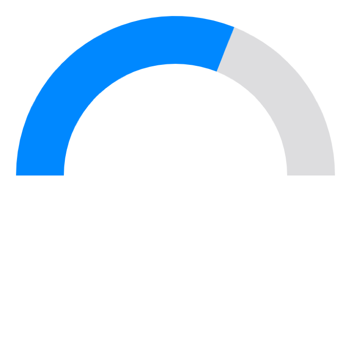

# Gauge (half ring)



## Visual signature

An arc, usually half a circle, partly filled with colour from one end, the rest a pale track. Often a number sits beneath or inside the arch.

## Composition

**Verdict: escape hatch.** Swift Charts has no gauge mark and no way to set a sector chart's start or total angle. This form uses two behaviours together, both allowed by the interface and shown in the recipe's render: a `SectorMark` angle can be a range that places the sector explicitly, and a chart is a view that can be rotated. Minimum iOS 17.0.

- Three sectors with angle ranges: the filled part, the track, and a clear sector that occupies the other half of the circle.
- `rotationEffect(.degrees(-90))` turns the half ring, which would run from 12 o'clock to 6 o'clock, into an arch.

<!-- snippet: Gallery/DonutChart.swift#gauge -->
```swift
@available(iOS 17.0, macOS 14.0, tvOS 17.0, watchOS 10.0, *)
struct GaugeRecipe: View {
    /// From 0 to 1. Clamped below, so neither range is ever reversed (a reversed range traps).
    let progress: Double

    private var value: Double {
        progress.isNaN ? 0 : min(max(progress, 0), 1)
    }

    var body: some View {
        Chart {
            // The value and its track are one element, so the gauge is read at every value, 0% included.
            Plot {
                // A sector with an empty range is left out: none at 0%, no track at 100%.
                if value > 0 {
                    SectorMark(angle: .value("Progress", 0 ..< value), innerRadius: .ratio(0.7))
                        .foregroundStyle(.blue)
                }
                if value < 1 {
                    SectorMark(angle: .value("Remaining", value ..< 1), innerRadius: .ratio(0.7))
                        .foregroundStyle(.gray.opacity(0.3))
                }
            }
            .accessibilityLabel("Progress")
            .accessibilityValue(Text(value, format: .percent.precision(.fractionLength(0))))
            // Takes the other half of the circle and draws nothing there.
            SectorMark(angle: .value("Unused", 1.0 ..< 2.0))
                .foregroundStyle(.clear)
                .accessibilityHidden(true)
        }
        // Sectors start at 12 o'clock; a quarter turn back starts the half ring at 9 o'clock.
        .rotationEffect(.degrees(-90))
    }
}
```

## Accessibility

The value and its track share one labelled `Plot`, so the gauge is one element at every value; the recipe's original form labelled the value's sector alone and hid the track, which left no element at 0%. The value is clamped first: a reversed range (`progress ..< 1` with progress above 1) traps, and a sector with an empty range is left out. In right to left the whole gauge mirrors and fills from the trailing side, which reads correctly. A gauge has no automatic Audio Graph: attach a single-value chart descriptor (`../audio-graph.md`).

## Pitfalls

- The chart still occupies a full square; the lower half is empty. Place the label there with an overlay, or offset what follows.
- `rotationEffect` turns everything in the chart, so a legend or annotation would be rotated too. Keep both out of the chart and build labels outside it.
- For a plain progress or level indicator, SwiftUI's own `Gauge` view is the system control. Use a chart only when the design needs what `Gauge` cannot draw.
