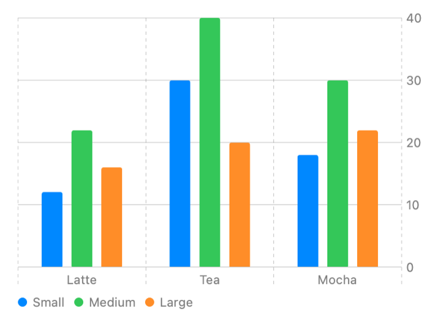

# Grouped bar chart



## Visual signature

Bars arranged in clusters: each category on the axis holds several narrower bars standing side by side, one per sub-category, each in its own colour, with a legend. Every bar rises from the baseline. Not this form if the coloured pieces sit on top of each other (`stacked-bar.md`).

## Composition

- The same data and `BarMark` as a stacked bar chart, minimum iOS 16.0.
- `foregroundStyle(by:)` colours the bars; on its own it would stack them.
- `position(by:axis:)` on the same property places them side by side within the category's band instead.

<!-- snippet: Gallery/GroupedBarChart.swift#chart -->
```swift
Chart(orders) { order in
    BarMark(
        x: .value("Drink", order.drink),
        y: .value("Cups", order.cups)
    )
    .foregroundStyle(by: .value("Size", order.size))
    .position(by: .value("Size", order.size), axis: .horizontal)
}
```

## Variations

- `position(by:axis:span:)` takes a `span:` that limits how much of the band the group may use, for wider gaps between groups.

## Accessibility

By default each group is one element, read as the total of its bars ("Latte, total 128, 3 Sizes", read on iOS), exactly as a stack would be: nothing says the bars stand side by side, and no bar's own value is heard. Wrap each bar in a labelled `Plot` so each is read with its own value (`../accessibility.md`). As on stacked bars, the cue beside colour is a direct label on each bar (`stacked-bar.md`).

## Pitfalls

- Use grouped bars to compare the sub-categories with each other; use stacked bars when the total per category matters more.
- Encode colour and position with the same property.
