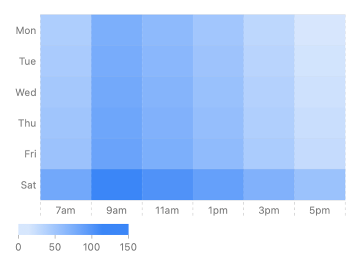
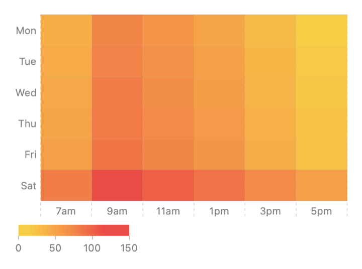
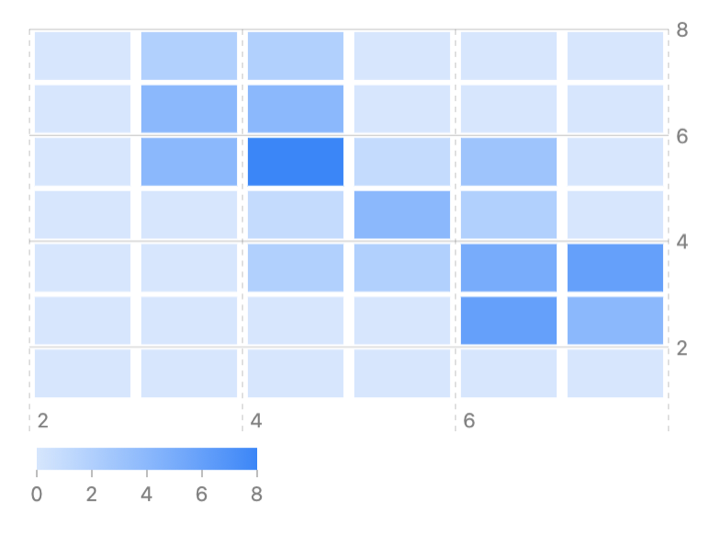

# Heat map



## Visual signature

A grid of rectangular cells, one for every combination of a category on x and a category on y. Each cell's colour, light to dark along one gradient, shows a number. There are no bars or lines. The legend is a gradient strip with numbers under it, not a row of swatches.

## Composition

- `RectangleMark(x:y:width:height:)` with a category on each axis, minimum iOS 16.0.
- `foregroundStyle(by:)` on the number. A numeric value gives a continuous colour scale and the gradient legend.
- `width: .ratio(1)` and `height: .ratio(1)` so cells touch. The default is 70% of the band, which leaves gaps.
- Row labels moved outside the plot with `AxisMarks(preset: .aligned, position: .leading)`.

<!-- snippet: Gallery/HeatMapChart.swift#recipe -->
```swift
struct HeatMapRecipe: View {
    let cells: [HourlyOrders]

    var body: some View {
        Chart(cells) { cell in
            RectangleMark(
                x: .value("Hour", cell.hour),
                y: .value("Day", cell.weekday),
                width: .ratio(1),
                height: .ratio(1)
            )
            .foregroundStyle(by: .value("Orders", cell.orders))
        }
        // Row labels outside the plot, so the cells get the whole row.
        .chartYAxis {
            AxisMarks(preset: .aligned, position: .leading)
        }
    }
}
```

## Variations

**Another colour ramp.** Pass a `Gradient` as the range of the colour scale. Keep its light end apart from what the chart sits on: `systemGray6` is the colour of a grouped panel in Dark Mode, so the lowest cells vanish there; `Color(.systemGray3)` to `Color(.label)` runs light to dark in Light Mode and dark to light in Dark Mode, both visible (rendered on iOS). Give the scale a domain spanning the values shown (`../scales.md`).



<!-- snippet: Gallery/HeatMapChart.swift#gradient -->
```swift
struct GradientHeatMap: View {
    let cells: [HourlyOrders]

    var body: some View {
        HeatMapRecipe(cells: cells)
            .chartForegroundStyleScale(range: Gradient(colors: [.yellow, .red]))
    }
}
```

**A key that stays readable at large text.** The automatic gradient legend labels round values, which can lie past the domain, and collides at large text (`../legend.md`). A key of your own, a strip with the domain's two ends, stayed readable at `.accessibility5` (iOS render):

<!-- snippet: Gallery/HeatMapChart.swift#own-key -->
```swift
struct HeatMapWithOwnKey: View {
    let cells: [HourlyOrders]
    /// Fixed, so the key's two numbers are the ends of the colours drawn.
    let domain: ClosedRange<Int>
    private let gradient = Gradient(colors: [.yellow, .red])

    var body: some View {
        HeatMapRecipe(cells: cells)
            .chartForegroundStyleScale(domain: domain, range: gradient)
            // In place of the gradient legend, whose numbers collide at large text: a strip and its two ends.
            .chartLegend(position: .bottom, alignment: .leading, spacing: 12) {
                VStack(alignment: .leading, spacing: 4) {
                    Text("Orders")
                    LinearGradient(gradient: gradient, startPoint: .leading, endPoint: .trailing)
                        .frame(height: 10)
                        .clipShape(RoundedRectangle(cornerRadius: 2))
                    HStack {
                        Text(domain.lowerBound, format: .number)
                        Spacer()
                        Text(domain.upperBound, format: .number)
                    }
                }
                .font(.caption)
                .foregroundStyle(Color.secondary) // or it takes the tint colour
                .frame(maxWidth: 220)
            }
    }
}
```

**Numbers on both axes.** Bin each axis and pass the bins as the x and y values. The axes are then continuous, and `.ratio(0.9)` leaves a thin gap between cells. The automatic labels fall on bin boundaries only when the axis's own stride happens to match the bin size; pass the boundaries, `AxisMarks(values: bins.thresholds)`, to put a label on each. Left at its defaults this version is wrong in its own way: each cell is about 70% of its bin, and both number scales start at zero and run past the bins, so set the sizes and the scale domains.



<!-- snippet: Dashboard/DashboardPatterns.swift#binned-heat-map -->
```swift
/// A two-dimensional histogram: both axes are numbers, binned, and colour is the count.
struct BinnedHeatMap: View {
    let beans: [Bean]

    private struct Cell: Identifiable {
        let id: String
        let acidity: ChartBinRange<Double>
        let body: ChartBinRange<Double>
        let count: Int
    }

    private var cells: [Cell] {
        let acidityBins = NumberBins(size: 1.0, range: 2.0 ... 8.0)
        let bodyBins = NumberBins(size: 1.0, range: 1.0 ... 8.0)
        let grouped = Dictionary(grouping: beans) {
            [acidityBins.index(for: $0.acidity), bodyBins.index(for: $0.body)]
        }
        // A cell for every combination, including the empty ones, so the grid has no holes.
        return acidityBins.indices.flatMap { column in
            bodyBins.indices.map { row in
                Cell(id: "\(column)-\(row)", acidity: acidityBins[column], body: bodyBins[row],
                     count: grouped[[column, row]]?.count ?? 0)
            }
        }
    }

    var body: some View {
        Chart(cells) { cell in
            RectangleMark(
                x: .value("Acidity", cell.acidity),
                y: .value("Body", cell.body),
                width: .ratio(0.9),
                height: .ratio(0.9)
            )
            .foregroundStyle(by: .value("Beans", cell.count))
        }
        .chartXScale(domain: 2 ... 8)
        .chartYScale(domain: 1 ... 8)
    }
}
```

The recipe bins in a computed property, which runs again on every redraw. For a large collection, bin once when the data changes, in the model, and pass the cells in (`../vectorized-plots.md`, *Keeping a large plot fast*).

**Many cells** (iOS 18.0+): `RectanglePlot` (`../vectorized-plots.md`).

## Accessibility

By default each column is one element giving the average of its cells, unrounded, and a count of the rows ("6 am", "average 46.857143, 7 Days"; `../accessibility-defaults.md`), so the individual cells are lost, and there is no automatic Audio Graph. Wrap each cell in a `Plot` labelled with both categories and the value, and write a chart descriptor with one series per row (`../accessibility.md`, `../audio-graph.md`).

## Pitfalls

- **"Light to dark" is the Light Mode ramp.** In Dark Mode the default gradient runs from near-black for low values to bright for high ones. Do not describe the cells as darker or lighter in text beside the chart.
- **Left at its defaults the chart is not a grid.** The row names are drawn inside the plot, above each row, and the cells shrink to thin strips beneath them. Move the row labels outside and set both sizes, as in the recipe.
- The data needs a row for every cell. A missing combination leaves a hole.
- The gradient legend's numbers are not thinned at large text: "0 20 40 60 80" collided at `.accessibility3` (iOS render). Draw your own key, as in *Variations*.
