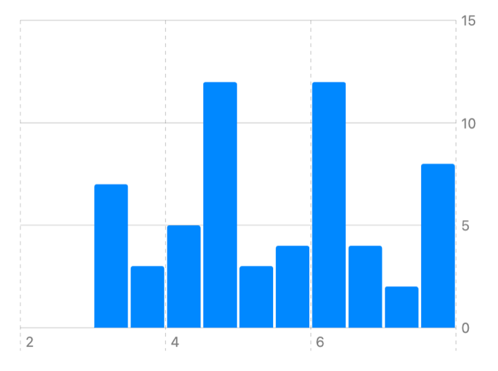
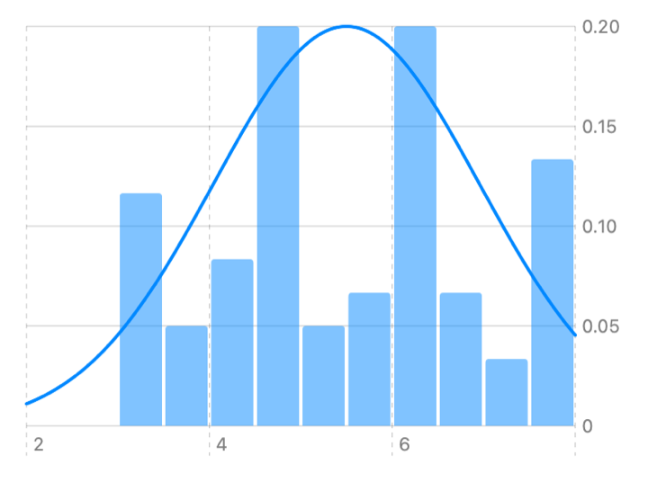

# Histogram



## Visual signature

Bars that touch or nearly touch, standing on a continuous number (or date) axis whose labels are values at the boundaries, not a name per bar. The other axis is a count. It shows how values are distributed. Not this form if each bar has its own category name beneath it and gaps between bars (`bar.md`).

## Composition

- Bin the values with `NumberBins`, count the elements in each bin, and plot one `BarMark` per bin with the bin as its x value. Minimum iOS 16.0.
- `width: .inset(1)` so neighbouring bars sit a hairline apart; `.ratio(1)` makes them touch.
- The x scale without its zero baseline, so the bars fill the plot.

<!-- snippet: Data/BinSnippets.swift#histogram -->
```swift
struct HistogramRecipe: View {
    let beans: [Bean]

    /// One entry per bin: the range it covers and how many beans fall in it.
    private var counts: [(range: ChartBinRange<Double>, count: Int)] {
        let bins = NumberBins(data: beans.map(\.acidity), desiredCount: 8)
        let grouped = Dictionary(grouping: beans) { bins.index(for: $0.acidity) }
        return bins.indices.map { index in
            (range: bins[index], count: grouped[index]?.count ?? 0)
        }
    }

    var body: some View {
        Chart(counts, id: \.range.lowerBound) { bin in
            BarMark(
                x: .value("Acidity", bin.range),
                y: .value("Beans", bin.count),
                // Neighbouring bars one hairline apart; the default leaves wide gaps.
                width: .inset(1)
            )
        }
        .chartXScale(domain: .automatic(includesZero: false))
    }
}
```

## Variations

**Totals per period:** `DateBins` in place of `NumberBins`, and a sum in place of a count (`../data.md`).

**With a fitted curve** (iOS 18.0+). A function `LinePlot` over the bars, scaled by the bin width so its area matches theirs: a bar's share is the density times the width (for counts, times the count as well). Do not scale it so its peak meets the tallest bar; that forces an agreement the data may not have. Let the y domain hold the curve's peak too. Over bars, the curve's own element is read in the order of its frame's top, not along x: give VoiceOver full-height stretches per bin that carry both values (`vectorized-plots.md`, *Accessibility*).



<!-- snippet: Dashboard/DashboardPlots.swift#histogram-curve -->
```swift
/// A histogram with the fitted normal curve drawn over it.
@available(iOS 18.0, macOS 15.0, tvOS 18.0, watchOS 11.0, visionOS 2.0, *)
struct HistogramWithCurve: View {
    let values: [Double]

    var body: some View {
        let bins = NumberBins(data: values, desiredCount: 8)
        let grouped = Dictionary(grouping: values, by: bins.index(for:))
        let shares = bins.indices.map { index in
            (range: bins[index], share: Double(grouped[index]?.count ?? 0) / Double(values.count))
        }
        let mean = values.reduce(0, +) / Double(values.count)
        let deviation = sqrt(values.map { pow($0 - mean, 2) }.reduce(0, +) / Double(values.count))
        // A bar's share is the curve's density times the bin's width, so scale the curve by
        // the width: then its area matches the bars', whatever the tallest bar happens to be.
        let width = bins.indices.first.map { bins[$0].upperBound - bins[$0].lowerBound } ?? 1

        Chart {
            ForEach(shares, id: \.range.lowerBound) { bin in
                BarMark(x: .value("Acidity", bin.range), y: .value("Share", bin.share), width: .inset(1))
                    .opacity(0.5)
            }
            LinePlot(x: "Acidity", y: "Normal curve") { [mean, deviation, width] x in
                width * exp(-pow((x - mean) / deviation, 2) / 2) / (deviation * (2 * .pi).squareRoot())
            }
            .foregroundStyle(Color.primary)
        }
        .chartXScale(domain: .automatic(includesZero: false))
    }
}
```

**Two-dimensional:** bin on both axes and colour `RectangleMark`s by count: see `heat-map.md`.

## Pitfalls

- `NumberBins(data:desiredCount:)` returns no bins at all when the data has a single distinct value (one value, or every value equal), so the chart is empty. Give it a range of its own, `NumberBins(range: v ... v + 1, desiredCount:)`, in that case.
- `desiredCount` is approximate; check how many bins came back.
- All of the binning pitfalls in `../data.md`.
