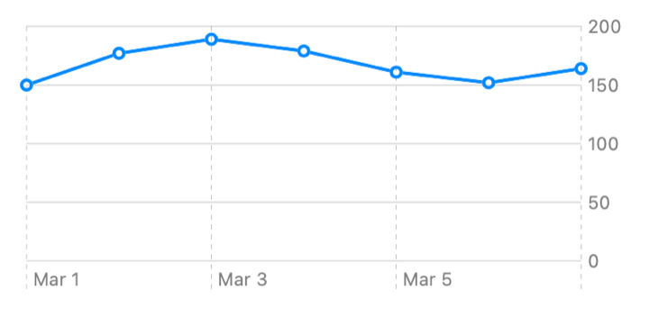
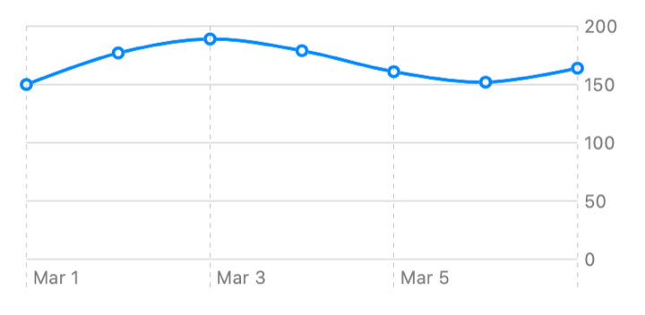
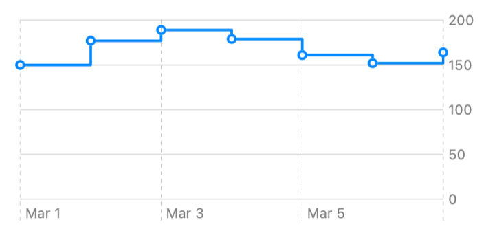

# Line shapes: straight, smooth and stepped

## Visual signature

How a line travels between its points identifies the interpolation method:

| Straight segments with corners at the points | A curve with no corners | A staircase of flat runs and vertical jumps |
|---|---|---|
|  |  |  |
| `.linear`, the default | `.catmullRom` (also `.cardinal`, `.monotone`) | `.stepEnd` (also `.stepStart`, `.stepCenter`) |

In a stepped line, look at where the jump happens relative to the points: at the following point (`.stepEnd`), at the point itself (`.stepStart`), or midway (`.stepCenter`). Apple's documentation words it from the jump's side: under `.stepEnd` the point is "at the end of the step", the top of the jump into it (`../mark-configuration.md`).

## Composition

`interpolationMethod(_:)` on a `LineMark` or `AreaMark`, minimum iOS 16.0. Choosing between the methods: `InterpolationMethod` in `../mark-configuration.md`.

<!-- snippet: Marks/MarkConfiguration.swift#interpolation -->
```swift
struct InterpolatedLine: View {
    let days: [DailySales]
    let method: InterpolationMethod

    var body: some View {
        Chart(days) { day in
            LineMark(x: .value("Day", day.day), y: .value("Cups", day.cups))
                .interpolationMethod(method)
                .symbol(.circle)
        }
    }
}
```

## Pitfalls

- A smooth curve can overshoot the data between points. Use `.monotone` when it must not.
