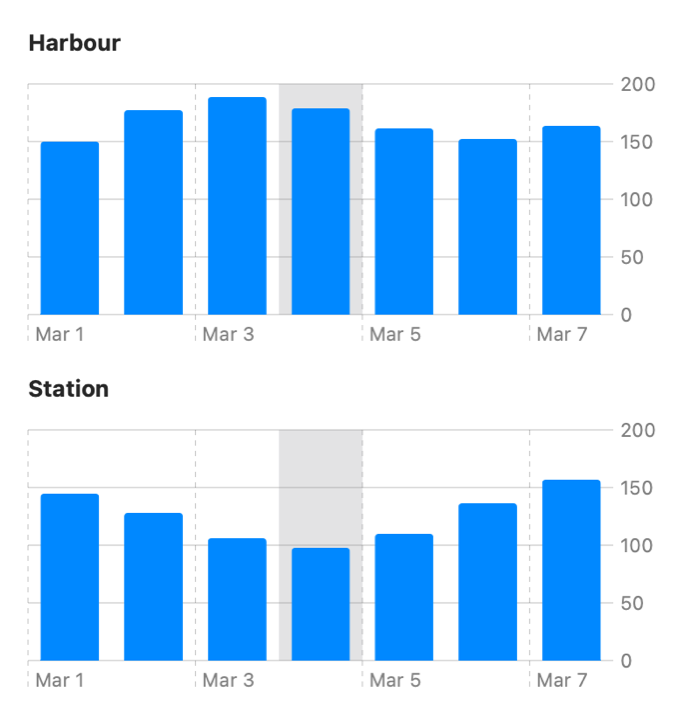

# Linked charts



## Visual signature

Two or more charts on one screen, usually sharing an axis, where the same period or item is highlighted in each: a shaded band behind the same bar, or the same point enlarged. Touching one chart moves the highlight in all of them, and nearby figures or other charts may narrow to the highlighted item. Typical of dashboards. Without the shared highlight it is `small-multiples.md`.

## Composition

- Each chart binds `chartXSelection` to the same value. Minimum iOS 17.0.
- A `RectangleMark` band, written once as a `ChartContent` type, drawn in every chart while a selection exists.
- The same x domain on every chart, and the same y domain where heights should compare.

<!-- snippet: Dashboard/DashboardPatterns.swift#linked -->
```swift
/// Two charts that share one selection: touching either highlights the same day in both.
@available(iOS 17.0, macOS 14.0, tvOS 17.0, watchOS 10.0, *)
struct LinkedCharts: View {
    let stores: [StoreSales]
    @State var selectedDay: Date?

    var body: some View {
        VStack(alignment: .leading, spacing: 16) {
            ForEach(stores) { store in
                Text(store.store).font(.headline)
                Chart {
                    if let selectedDay {
                        SelectedDayBand(day: selectedDay)
                    }
                    ForEach(store.days) { day in
                        BarMark(
                            x: .value("Day", day.day, unit: .day),
                            y: .value("Cups", day.cups)
                        )
                    }
                }
                // The same domain and the same binding on every chart.
                .chartYScale(domain: 0 ... 200)
                .chartXSelection(value: $selectedDay)
            }
        }
    }
}
```

<!-- snippet: Dashboard/DashboardPatterns.swift#selection-band -->
```swift
/// A band behind the marks for the selected day, as a reusable piece of chart content.
struct SelectedDayBand: ChartContent {
    let day: Date

    var body: some ChartContent {
        RectangleMark(
            x: .value("Selected day", day, unit: .day),
            width: .ratio(1)
        )
        .foregroundStyle(.gray.opacity(0.25))
        // Decoration: the bars already describe the day.
        .accessibilityHidden(true)
    }
}
```

## Variations

**Filtering other views to the selection.** Derive the selected period from the bound value in the model and filter the data other charts show. Fix those charts' colour and size scale domains so nothing changes colour as the subset changes (`../scales.md`).

**A chart as the control.** A small chart of categories whose bars switch what the other charts are coloured by, standing in for a legend (`../design.md`).

## Pitfalls

- The bound value is the raw position, not a data point. The band's `unit:` places it on the right day for drawing; snap the value yourself before using it to look anything up (`../interaction.md`).
- On an iOS 16 target the selection modifier has to be gated. Replace `chartXSelection` with the gated modifier under *Custom gestures* in `../interaction.md`, which falls back to an overlay gesture writing the same binding; the band and everything else here are iOS 16.0.
