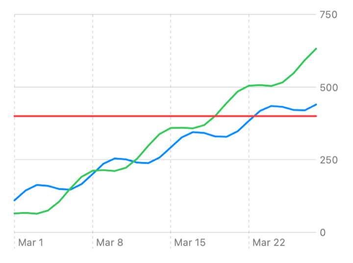
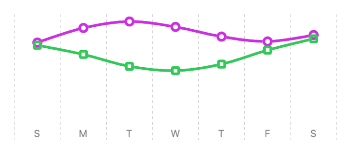

# Multi-series line chart



## Visual signature

Two or more continuous lines across a shared horizontal axis (usually time), each a different colour or with a different point symbol. A perfectly straight horizontal line across the full width is a threshold or target, not a data series.

## Composition

- `Chart { }` with one `ForEach` per series, each producing `LineMark`s. Minimum iOS 16.0.
- Each `LineMark` names its series with the `series:` parameter. That is what keeps the lines separate.
- A `RuleMark(y:)` draws the threshold across the whole plot width.

<!-- snippet: Gallery/MultiSeriesLineChart.swift#chart -->
```swift
Chart {
    ForEach(harbour) { item in
        LineMark(
            x: .value("Day", item.day),
            y: .value("Cups", item.cups),
            series: .value("Store", "Harbour")
        )
        .foregroundStyle(.blue)
    }
    ForEach(station) { item in
        LineMark(
            x: .value("Day", item.day),
            y: .value("Cups", item.cups),
            series: .value("Store", "Station")
        )
        .foregroundStyle(.green)
    }
    RuleMark(y: .value("Target", target))
        .foregroundStyle(.red)
        .accessibilityLabel("Target")
}
```

## Variations

**Series from the data, with symbols and a custom look.** When the series are in the data, nest the `ForEach` and encode the series name with `foregroundStyle(by:)` and `symbol(by:)`; either one separates the lines, so `series:` is not needed. Modifiers on the outer `ForEach` apply to every line.



<!-- snippet: Gallery/MultiSeriesLineChart.swift#styled -->
```swift
Chart {
    ForEach(stores) { store in
        ForEach(store.days) { item in
            LineMark(
                x: .value("Day", item.day, unit: .day),
                y: .value("Cups", item.cups)
            )
        }
        .foregroundStyle(by: .value("Store", store.store))
        .symbol(by: .value("Store", store.store))
    }
    .interpolationMethod(.catmullRom)
    .lineStyle(StrokeStyle(lineWidth: 3))
    .symbolSize(100)
}
.chartForegroundStyleScale(["Harbour": .purple, "Station": .green])
.chartSymbolScale([
    "Harbour": Circle().strokeBorder(lineWidth: 3),
    "Station": RoundedSquare().strokeBorder(lineWidth: 3),
])
.chartXAxis {
    AxisMarks(values: .stride(by: .day)) { _ in
        AxisTick()
        AxisGridLine()
        AxisValueLabel(format: .dateTime.weekday(.narrow), centered: true)
    }
}
.chartYAxis(.hidden)
.chartYScale(range: .plotDimension(endPadding: 8))
.chartLegend(.hidden)
```

The square is a custom symbol:

<!-- snippet: Gallery/MultiSeriesLineChart.swift#symbol -->
```swift
/// A custom symbol. Its path is drawn in `perceptualUnitRect` scaled by the symbol size.
/// The circle reports a slightly larger rectangle than the unit square, sized so its area
/// equals the square's, so the unit square gives this square the circle's area.
struct RoundedSquare: ChartSymbolShape, InsettableShape {
    var inset: CGFloat = 0

    func path(in rect: CGRect) -> Path {
        let side = min(rect.width, rect.height) - inset * 2
        let square = CGRect(x: rect.midX - side / 2, y: rect.midY - side / 2, width: side, height: side)
        return Path(roundedRect: square, cornerRadius: 1)
    }

    func inset(by amount: CGFloat) -> RoundedSquare {
        RoundedSquare(inset: inset + amount)
    }

    var perceptualUnitRect: CGRect {
        CGRect(x: 0, y: 0, width: 1, height: 1)
    }
}
```

What each modifier in the styled version does:

- `interpolationMethod(.catmullRom)` curves the line through the points.
- `symbol(by:)` with `chartSymbolScale` gives each series its own point shape, so the series are distinguishable without colour.
- `chartYScale(range: .plotDimension(endPadding: 8))` keeps 8 points of the plot area's height free at the top (rendered with 40), so the highest points and their symbols are not drawn against the edge.
- `chartYAxis(.hidden)` and `chartLegend(.hidden)` remove chrome for a compact size; label the series some other way (see `compact.md`).

## Accessibility

This recipe tells the lines apart only by `series:` and fixed colours, so by default they are read as one line: stretches of dates pooling both stores ("152 to 202, increases consistently, 4 values"), and one unnamed Audio Graph series of every point. No store is named or counted (read on iOS). The styled version's encodings give each date the first store's value to the last's and "2 series", since colour and symbol share the field (`../accessibility-defaults.md`). Wrap each point's mark in a `Plot` labelled with the store and the written-out date, or describe a stretch per plot on a long series. The target rule is its own element and is labelled directly, as the recipe does. Name each series in the chart descriptor (`../accessibility.md`, `../audio-graph.md`).

## Pitfalls

- **Without `series:` or a `by:` encoding, all `LineMark`s join into one line**, which doubles back from the end of one data set to the start of the next. If a line chart shows a stray diagonal, this is why.
- With fixed colours per series (`.foregroundStyle(.blue)`) there is no legend, and nothing says which line is which. Use `foregroundStyle(by:)` when the chart needs a legend, or label each line at its end (`../annotations.md`); either way give the series a second difference besides colour.
