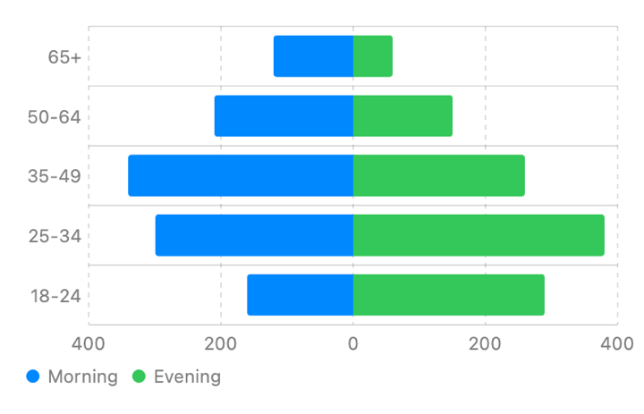

# Population pyramid (back-to-back bars)



## Visual signature

Horizontal bars growing in opposite directions from a centre line, one row per group, with one colour on each side and a legend. Both halves of the value axis count upward away from the centre. It compares two populations across the same groups.

## Composition

- One `BarMark` per row and side, with one side's values negated so its bars grow leftward. Minimum iOS 16.0.
- `foregroundStyle(by:)` on the side.
- A custom `AxisValueLabel` showing the absolute value, so the left half is not labelled with negative numbers.
- Row labels moved outside the plot with the `.aligned` preset.
- The value axis uses the `.aligned` preset as well. Without it the trailing grid line has no label, so one side reads as shorter than the other (`../axes.md`).

<!-- snippet: Sessions/SessionPatterns.swift#pyramid -->
```swift
struct PopulationPyramidRecipe: View {
    let visits: [AgeGroupVisits]
    let leftSide: String

    var body: some View {
        Chart(visits) { item in
            // A Plot per bar, so each side is read with its real, positive number.
            Plot {
                BarMark(
                    // One side is plotted as negative values so its bars grow leftward from the centre.
                    x: .value("Visits", item.period == leftSide ? -item.visits : item.visits),
                    y: .value("Age", item.ageGroup)
                )
                .foregroundStyle(by: .value("Period", item.period))
            }
            .accessibilityLabel("\(item.ageGroup), \(item.period)")
            .accessibilityValue(Text("^[\(item.visits) visit](inflect: true)"))
        }
        .chartXAxis {
            // The aligned preset centres each label on its line, so the trailing line is labelled too.
            AxisMarks(preset: .aligned) { value in
                AxisGridLine()
                // Label both sides with the size of the value, without the minus sign.
                AxisValueLabel {
                    if let visits = value.as(Int.self) {
                        Text(abs(visits), format: .number)
                    }
                }
            }
        }
        .chartYAxis {
            AxisMarks(preset: .aligned, position: .leading)
        }
    }
}
```

## Accessibility

The two bars of a row share one accessibility element, whose automatic value is their total, with one side counted negative, and a count of the periods ("Under 18", "total -130, 2 Periods", read on iOS), and values set on the bars are not read. The recipe wraps each bar in a `Plot` labelled with the real number (`../accessibility.md`, *One element per `Plot`*).

