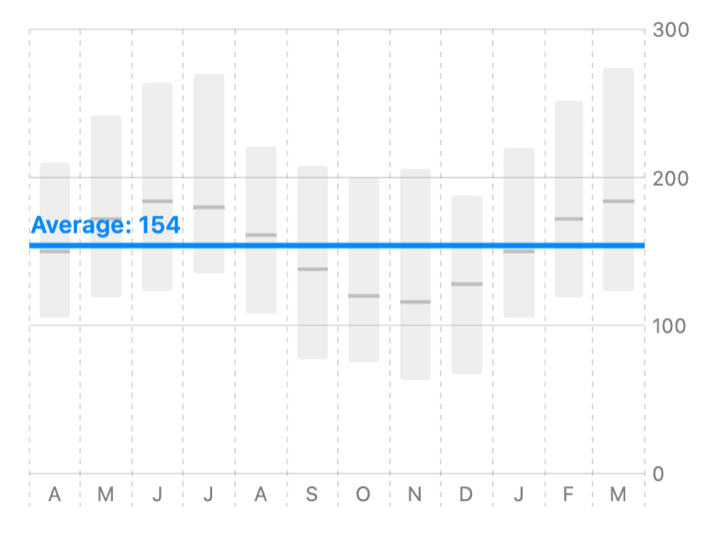

# Range bar with average



## Visual signature

Bars that float: each starts at a low value and ends at a high value instead of rising from the baseline. A thin horizontal tick inside each bar marks a typical value. Often a single thick line crosses the whole chart for an overall average, with a text label sitting on it.

## Composition

Three marks layered in one chart, minimum iOS 16.0:

- `BarMark(x:yStart:yEnd:width:)` for the range, made faint with `opacity`.
- `RectangleMark(x:y:width:height:)` with `height: .fixed(2)` for the tick. A fixed height in points keeps it a thin line whatever the scale.
- `RuleMark(y:)` for the overall average, with `annotation` for its label.

Both per-month marks use the same `x` value and `width: .ratio(0.6)` so the tick lines up with its bar.

<!-- snippet: Gallery/RangeBarChart.swift#chart -->
```swift
Chart {
    ForEach(months) { month in
        BarMark(
            x: .value("Month", month.month, unit: .month, calendar: calendar),
            yStart: .value("Lowest day", month.dailyMin),
            yEnd: .value("Highest day", month.dailyMax),
            width: .ratio(0.6)
        )
        .opacity(0.3)
        RectangleMark(
            x: .value("Month", month.month, unit: .month, calendar: calendar),
            y: .value("Average day", month.dailyAverage),
            width: .ratio(0.6),
            height: .fixed(2)
        )
    }
    .foregroundStyle(showsAverage ? AnyShapeStyle(.gray.opacity(0.5)) : AnyShapeStyle(.blue))

    if showsAverage {
        RuleMark(y: .value("Average", overallAverage))
            .foregroundStyle(.blue)
            .lineStyle(StrokeStyle(lineWidth: 3))
            .accessibilityLabel("Average")
            .accessibilityValue(Text("^[\(overallAverage) cup](inflect: true) a day"))
            .annotation(position: .top, alignment: .leading) {
                Text("Average: \(overallAverage.formatted(.number.locale(locale)))")
                    .font(.body.bold())
                    .foregroundStyle(.blue)
            }
    }
}
.chartXAxis {
    AxisMarks(values: .stride(by: .month, calendar: calendar)) { _ in
        AxisGridLine()
        AxisTick()
        AxisValueLabel(format: Date.FormatStyle(locale: locale, calendar: calendar, timeZone: calendar.timeZone).month(.narrow), centered: true)
    }
}
```

## Variations

- **Emphasis by toggle.** The recipe greys the per-month marks while the average line is showing, so only one thing is emphasised at a time. One `foregroundStyle` on the `ForEach` recolours every mark inside it.
- **Month initials.** `AxisValueLabel(format: .dateTime.month(.narrow), centered: true)` puts a one-letter label under the middle of each month's band.

## Accessibility

The bar and the tick share each month, and by default the element is a range of dates whose value is the tick's number and a count of the bar's two value labels ("150, 2 Lowest days to Highest day"); the bar's own values are not read. Put both marks in one `Plot` labelled with the month and valued with the low, high and average. For the Audio Graph, write a descriptor with one named series each for the low, the average and the high (`../audio-graph.md`). The average rule is its own element and is labelled directly, as the recipe does (`../accessibility.md`).

## Pitfalls

- Give the date `unit: .month` on every mark that shares the axis. Without a unit a date is a single instant: bars become narrow slivers centred on the first moment of each month, and the first and last hang half outside the plot, over the axis (`../data.md`).
- Put the annotation on the `RuleMark`, not in an overlay: it then tracks the value when the data changes.
