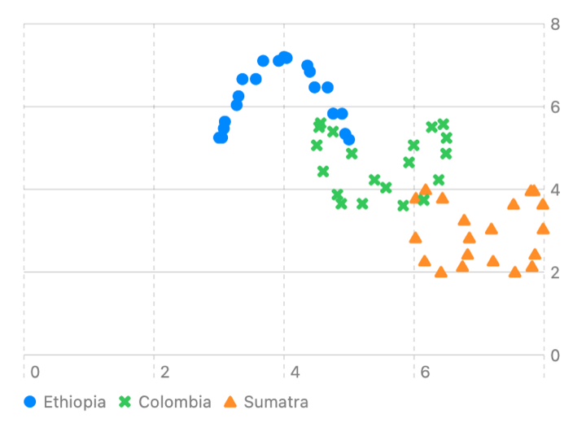
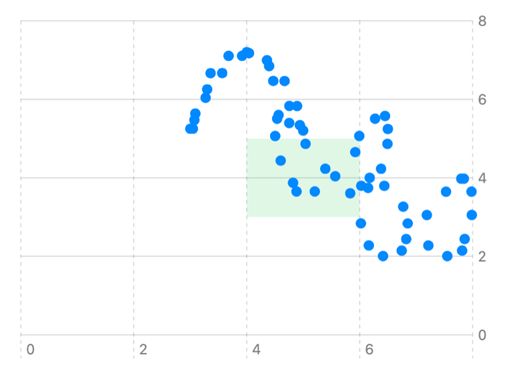
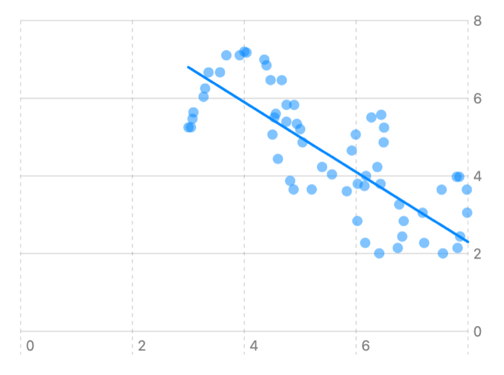
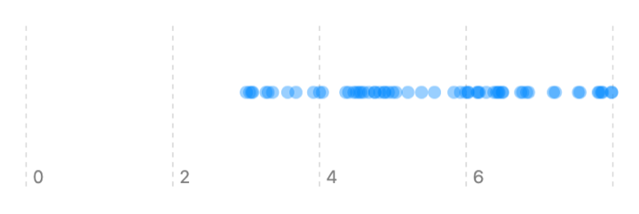
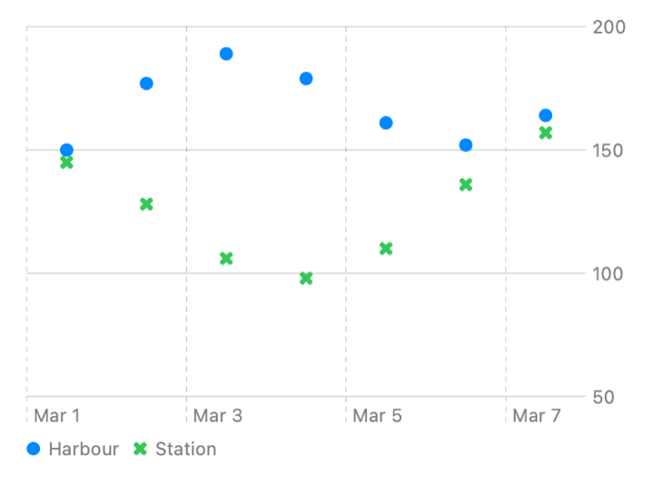
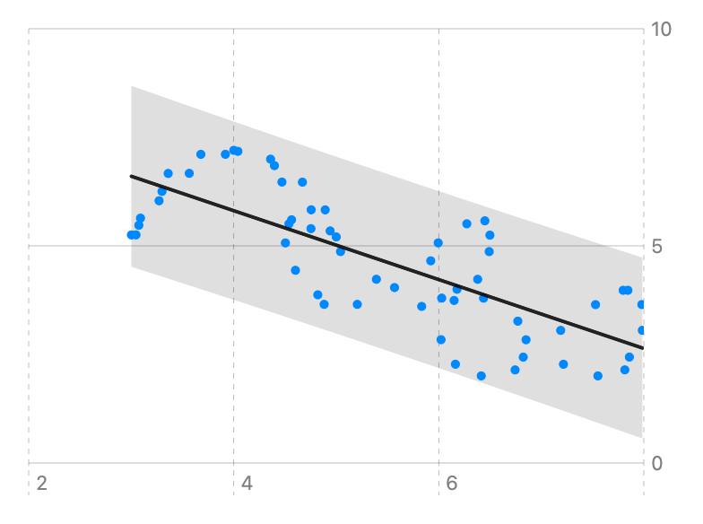
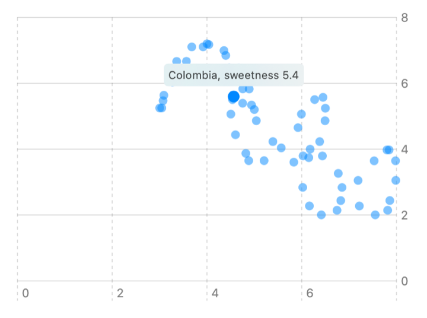
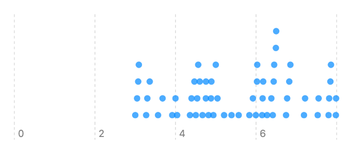

# Scatter plot



## Visual signature

Separate points scattered across the plot, each placed by a number on both axes, with nothing joining them. Both axes are number scales. Groups are told apart by colour, by symbol shape, or both, with a legend. Not this form if the points are joined (`multi-series-line.md`) or if one axis holds categories.

## Composition

- `PointMark(x:y:)` with a numeric property on each axis, minimum iOS 16.0.
- `foregroundStyle(by:)` and `symbol(by:)` on the same property, so groups differ by colour and by shape.

<!-- snippet: Gallery/ScatterChart.swift#recipe -->
```swift
struct ScatterChartRecipe: View {
    let beans: [Bean]

    var body: some View {
        Chart(beans) { bean in
            PointMark(
                x: .value("Acidity", bean.acidity),
                y: .value("Body", bean.body)
            )
            .foregroundStyle(by: .value("Origin", bean.origin))
            .symbol(by: .value("Origin", bean.origin))
        }
    }
}
```

## Variations

**A third quantity as size** (bubble chart): `symbolSize(by:)` with `chartSymbolSizeScale(range:)` (`../mark-modifiers.md`).

**A shaded region.** A `RectangleMark` given start and end values, declared before the points, marks a target zone. Code under `RectangleMark` in `../marks.md`.



**A trend line** (iOS 18.0+). A function `LinePlot` over the points; the app computes the fit (`../vectorized-plots.md`).



**One axis only.** `PointMark(x:)` puts every point on a single line, showing how the values are spread. Give the points opacity so crowded stretches look darker.



<!-- snippet: Gallery/ScatterChart.swift#strip -->
```swift
struct StripPlot: View {
    let beans: [Bean]

    var body: some View {
        Chart(beans) { bean in
            PointMark(x: .value("Acidity", bean.acidity))
                .opacity(0.4)
        }
    }
}
```

**Two series over time, told apart by shape as well as colour,** as in a blood-pressure chart. Code under *Colour* in `../design.md`.



**A band of uncertainty around the trend** (iOS 18.0+): a function `AreaPlot` between a low and a high curve, declared first so the points and the line lie over it, and limited to the data's range with `domain:`. Say which band it is. The one below is the 95% prediction band of a least-squares line, worked out in the model: where new points should fall, narrowest at the mean of x. For a few points use Student's t, not 1.96 (2.10 for 20 points), or the band is too narrow. A constant margin draws two parallel lines, which is neither band.



<!-- snippet: Dashboard/DashboardPlots.swift#band -->
```swift
/// A least-squares line, worked out in the model, and its 95% prediction band: where about
/// 95 in 100 new points should fall. It is narrowest at the mean of x and widens away from it.
struct TrendFit {
    let intercept, slope, residualSD, meanX, sxx: Double
    let count: Int
    let xRange: ClosedRange<Double>
    /// Student's t at 97.5% for count − 2 degrees of freedom (2.10 for 20 points; 1.96 only for large counts).
    let t: Double

    func trend(_ x: Double) -> Double { intercept + slope * x }
    /// Half the band's height at x. Drop the "1 +" for the band around the mean line instead.
    func margin(_ x: Double) -> Double {
        t * residualSD * (1 + 1 / Double(count) + pow(x - meanX, 2) / sxx).squareRoot()
    }
}

@available(iOS 18.0, macOS 15.0, tvOS 18.0, watchOS 11.0, visionOS 2.0, *)
struct TrendWithBand: View {
    let beans: [Bean]
    let fit: TrendFit

    var body: some View {
        Chart {
            // The band first, so the points and the line are drawn over it, and both stop
            // where the data does.
            AreaPlot(x: "Acidity", yStart: "Low", yEnd: "High", domain: fit.xRange) { [fit] x in
                (yStart: fit.trend(x) - fit.margin(x), yEnd: fit.trend(x) + fit.margin(x))
            }
            .foregroundStyle(Color.primary)
            .opacity(0.15)
            PointPlot(beans, x: .value("Acidity", \.acidity), y: .value("Body", \.body))
                .symbolSize(20)
            LinePlot(x: "Acidity", y: "Trend", domain: fit.xRange) { [fit] x in fit.trend(x) }
                .foregroundStyle(Color.primary)
        }
        .chartXScale(domain: 2 ... 8)
        .chartYScale(domain: 0 ... 10)
        .chartPlotStyle { $0.clipped() }
    }
}
```

**Selecting the nearest point** (iOS 17.0+): x and y selection together. Code under *Selecting on both axes* in `../interaction.md`.



**Thousands of points:** `PointPlot` on iOS 18.0+ (`../vectorized-plots.md`). On earlier targets, bin both axes and draw a two-dimensional histogram (`heat-map.md`).

## Beeswarm



A strip of points along one axis where points that would overlap are stacked instead, so the height of a pile shows how many values fall there. Swift Charts does not place points for you: compute a row for each point in the data (the first free row among its close neighbours), plot the row on a hidden y axis, and label each point's `Plot` so the row numbers are not read out as data. Rows are computed in data units, so at a narrower width or a wider domain neighbouring points can touch again: choose `crowding` for the narrowest width the chart is shown at. Its value axis includes zero, like any number scale (`../scales.md`); set the x domain when zero is not meaningful.

<!-- snippet: Community/CommunityPatterns.swift#beeswarm -->
```swift
struct BeeswarmRecipe: View {
    let beans: [Bean]
    /// Values closer than this would overlap, so they are stacked.
    var crowding = 0.12

    /// Each bean with the row it lands in: the first free row among its close neighbours.
    private var placed: [(bean: Bean, row: Int)] {
        var result: [(bean: Bean, row: Int)] = []
        for bean in beans.sorted(by: { $0.acidity < $1.acidity }) {
            let taken = Set(result.filter { abs($0.bean.acidity - bean.acidity) < crowding }.map(\.row))
            let row = (0...).first { !taken.contains($0) } ?? 0
            result.append((bean, row))
        }
        return result
    }

    var body: some View {
        Chart(placed, id: \.bean.id) { item in
            Plot {
                PointMark(
                    x: .value("Acidity", item.bean.acidity),
                    // The row only keeps points apart; it measures nothing, so its axis is hidden.
                    y: .value("Row", item.row)
                )
                .symbolSize(40)
                .opacity(0.7)
            }
            // Without this the row numbers would be read out as if they were data.
            .accessibilityLabel(item.bean.origin)
            .accessibilityValue("Acidity \(item.bean.acidity.formatted(.number.precision(.fractionLength(1))))")
        }
        .chartYAxis(.hidden)
        .chartYScale(domain: -0.5 ... Double((placed.map(\.row).max() ?? 0) + 1))
    }
}
```

## Accessibility

Points on two number axes are merged into ranges of x ("4 to 5, varies between 7.2 and 3.65, 17 values"). Wrap each point in a labelled `Plot` when the individual points matter, as the beeswarm does. A one-axis strip has no automatic Audio Graph (`../accessibility.md`, `../audio-graph.md`).

## Pitfalls

- Both axes start at zero by default, which can squeeze the points into a corner. Set the scale domains when zero is not meaningful (`../scales.md`).
- Default symbols are assigned circle, cross, triangle, plus, square, asterisk, diamond and then repeat. More than seven groups cannot be told apart by shape alone.
