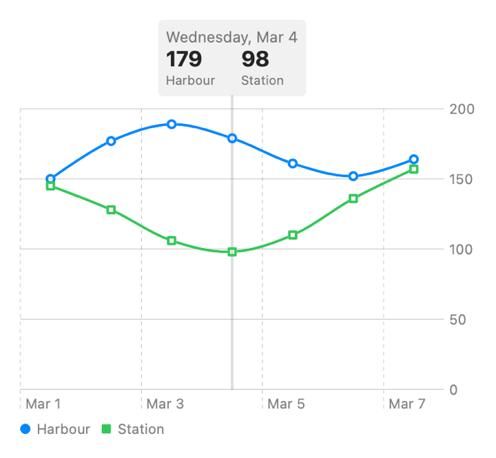
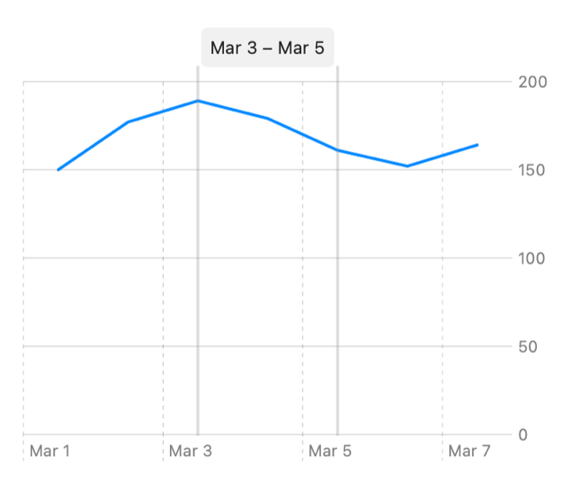
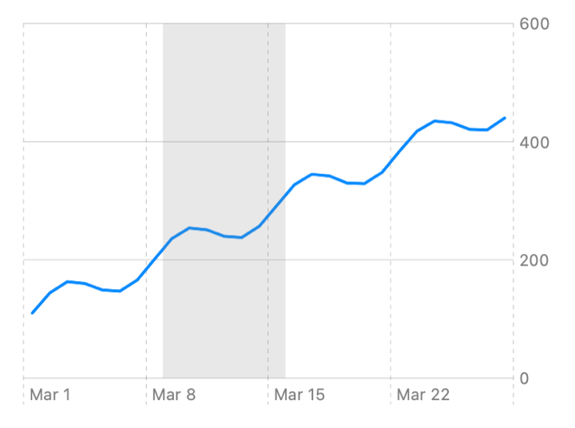

# Line chart with selection



## Visual signature

A line chart with a thin, faint vertical line at one horizontal position and a floating rounded label above the chart, centred on that line, giving the values of every series there. The label sits in the space above the plot area, where a title would otherwise be. A range selection shows two vertical lines with a label spanning them.

## Composition

Minimum iOS 17.0 for selection, annotation overflow control and `zIndex`.

- `chartXSelection(value:)` binds the position under the finger or pointer to an optional value.
- A computed property snaps that raw value to a data point.
- When there is a selection, a `RuleMark(x:)` marks it. `zIndex(-1)` puts it behind the lines; `offset(yStart: -10)` extends it upward to meet the label.
- `annotation(position: .top, ...)` on the rule holds the label. `overflowResolution: .init(x: .fit(to: .chart), y: .disabled)` slides the label sideways to stay inside the chart at the edges, and lets it extend above the plot area.

<!-- snippet: Gallery/SelectionLineChart.swift#chart -->
```swift
@available(iOS 17.0, macOS 14.0, tvOS 17.0, watchOS 10.0, *)
struct SelectionLineChartRecipe: View {
    let stores: [StoreSales]
    @State var rawSelectedDate: Date?
    /// The calendar the dates were recorded in: days are cut in it, not in the device's (`data.md`).
    var calendar = Calendar(identifier: .gregorian)

    /// The binding reports the exact position under the finger. Snap it to a day that has data.
    private var selectedDay: Date? {
        guard let rawSelectedDate else { return nil }
        return stores.first?.days.first { calendar.isDate($0.day, inSameDayAs: rawSelectedDate) }?.day
    }

    var body: some View {
        Chart {
            ForEach(stores) { store in
                ForEach(store.days) { item in
                    LineMark(
                        x: .value("Day", item.day, unit: .day),
                        y: .value("Cups", item.cups)
                    )
                }
                .foregroundStyle(by: .value("Store", store.store))
                .symbol(by: .value("Store", store.store))
                .interpolationMethod(.catmullRom)
            }

            if let selectedDay {
                RuleMark(x: .value("Selected", selectedDay, unit: .day))
                    .foregroundStyle(.gray.opacity(0.3))
                    // The indicator repeats what the marks already say.
                    .accessibilityHidden(true)
                    .offset(yStart: -10)
                    .zIndex(-1)
                    .annotation(
                        position: .top, spacing: 0,
                        overflowResolution: .init(x: .fit(to: .chart), y: .disabled)
                    ) {
                        SelectionPopover(day: selectedDay, stores: stores, calendar: calendar)
                    }
            }
        }
        .chartXSelection(value: $rawSelectedDate)
    }
}

struct SelectionPopover: View {
    let day: Date
    let stores: [StoreSales]
    let calendar: Calendar

    var body: some View {
        VStack(alignment: .leading) {
            // Formatted to a string in the data's time zone: `Text(date, format:)` uses the device's on iOS.
            Text(day.formatted(Date.FormatStyle(calendar: calendar, timeZone: calendar.timeZone).weekday(.wide).month().day()))
                .font(.callout)
                .foregroundStyle(.secondary)
            HStack(spacing: 20) {
                ForEach(stores) { store in
                    let cups = store.days.first { calendar.isDate($0.day, inSameDayAs: day) }?.cups ?? 0
                    VStack(alignment: .leading) {
                        Text(cups, format: .number).font(.title2.bold())
                        Text(store.store).font(.caption).foregroundStyle(.secondary)
                    }
                }
            }
        }
        .padding(6)
        .background(.gray.opacity(0.12), in: .rect(cornerRadius: 4))
    }
}
```

## Variations

**Range selection.** `chartXSelection(range:)` binds a `ClosedRange`. Group the two rules in a `Plot` so one annotation spans both; `context.targetSize.width` is the distance between them.



<!-- snippet: Gallery/SelectionLineChart.swift#range -->
```swift
@available(iOS 17.0, macOS 14.0, tvOS 17.0, watchOS 10.0, *)
struct RangeSelectionLineChartRecipe: View {
    let days: [DailySales]
    @State var selectedRange: ClosedRange<Date>?
    /// The calendar the dates were recorded in: days are cut in it, not in the device's (`data.md`).
    var calendar = Calendar(identifier: .gregorian)

    var body: some View {
        Chart {
            ForEach(days) { item in
                LineMark(
                    x: .value("Day", item.day, unit: .day, calendar: calendar),
                    y: .value("Cups", item.cups)
                )
            }

            if let selectedRange {
                Plot {
                    RuleMark(x: .value("Range start", selectedRange.lowerBound, unit: .day, calendar: calendar))
                    RuleMark(x: .value("Range end", selectedRange.upperBound, unit: .day, calendar: calendar))
                }
                .foregroundStyle(.gray.opacity(0.3))
                .accessibilityHidden(true)
                .offset(yStart: -10)
                .zIndex(-1)
                .annotation(
                    position: .top, spacing: 0,
                    overflowResolution: .init(x: .fit(to: .chart), y: .disabled)
                ) { context in
                    // Formatted to strings in the data's time zone: `Text(date, format:)` uses the device's on iOS.
                    let day = Date.FormatStyle(calendar: calendar, timeZone: calendar.timeZone).month().day()
                    Text("\(selectedRange.lowerBound.formatted(day)) – \(selectedRange.upperBound.formatted(day))")
                        .font(.callout)
                        .frame(minWidth: max(context.targetSize.width, 0), alignment: .leading)
                        .fixedSize()
                        .padding(6)
                        .background(.gray.opacity(0.12), in: .rect(cornerRadius: 4))
                }
            }
        }
        .chartXSelection(range: $selectedRange)
    }
}
```

Both selection modifiers can be applied to the same chart, each with its own binding.

**A range on iOS 16.** Without `chartXSelection(range:)`, convert the drag's start and current locations to values through the `ChartProxy` and draw the range as a `RectangleMark`. The same state can filter a list beneath the chart. On iOS 17 and later, drive the chart's own range selection from a gesture instead (`selectXRange(from:to:)`, `../interaction.md`). Inside a vertical scroll view this overlay drag takes the page's swipes: see the pitfall in `../interaction.md`.



<!-- snippet: Sessions/SessionPatterns.swift#brushing -->
```swift
/// Drag across the chart to select a range, on iOS 16 where `chartXSelection(range:)` does not exist.
struct BrushingChart: View {
    let days: [DailySales]
    @State var range: ClosedRange<Date>?

    var body: some View {
        Chart {
            if let range {
                // The selection is a mark, so it stays aligned with the data. Declared first, so it is drawn behind the line.
                RectangleMark(
                    xStart: .value("Selection start", range.lowerBound),
                    xEnd: .value("Selection end", range.upperBound)
                )
                .foregroundStyle(.gray.opacity(0.2))
                .accessibilityHidden(true)
            }
            ForEach(days) { day in
                LineMark(x: .value("Day", day.day, unit: .day), y: .value("Cups", day.cups))
            }
        }
        .chartOverlay { proxy in
            GeometryReader { geometry in
                Rectangle().fill(.clear).contentShape(Rectangle())
                    .gesture(
                        DragGesture()
                            .onChanged { drag in
                                let originX = geometry[proxy.plotAreaFrame].origin.x
                                let width = proxy.plotAreaSize.width
                                // Outside the plot a date scale still answers, with a date beyond the data:
                                // start a brush only inside the plot, and stop it at the plot's edges.
                                let startX = drag.startLocation.x - originX
                                guard (0 ... width).contains(startX) else { return }
                                let currentX = min(max(drag.location.x - originX, 0), width)
                                if let start: Date = proxy.value(atX: startX),
                                   let current: Date = proxy.value(atX: currentX) {
                                    range = min(start, current) ... max(start, current)
                                }
                            }
                    )
            }
        }
    }
}
```

## Accessibility

The selection rule, range rules and brush rectangle are hidden from assistive technologies, as the recipes do: they repeat what the marks say. With several series, wrap each point's mark in a labelled `Plot` (`../accessibility.md`).

## Pitfalls

- **The selection value is raw.** It is the exact position on the axis, for example 07:14 on a day, not the nearest data point. Snap it before drawing anything from it or looking up values.
- **Leave room above the chart.** With vertical overflow disabled the label draws outside the chart's frame. Reserve the space, or put the label where a title is and hide the title while a selection is active.
- **Keep the layout still while the finger moves.** A headline that follows the selection changes length, and if it wraps to fewer lines everything below it moves: on one screen the chart jumped 37 points under the finger. Reserve the height of the longest headline the chart can show, for example with a hidden copy of it behind the visible one. This is for a headline the finger or a scroll drives; one only a control changes reserves nothing, since at accessibility sizes the longest message can be several lines taller than the one shown, leaving a blank band above the chart (seen on several screens).
- Draw the indicator as a mark inside the chart, not as an overlay, so it stays aligned with the data when the chart resizes.
- On an iOS 16 deployment target, selection is built with `chartOverlay`, `ChartProxy` and a gesture: see `../availability/README.md`.
