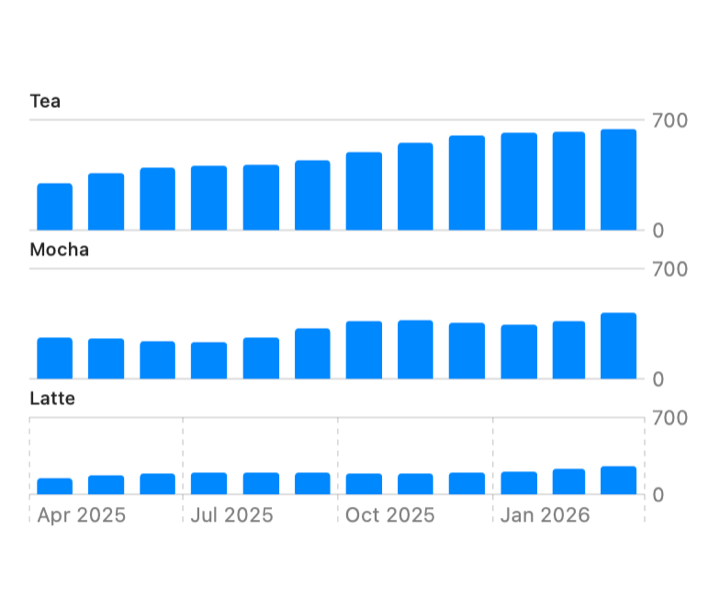

# Small multiples



## Visual signature

Several small charts of the same type stacked or laid out in a grid, one per category or measure, lined up on a shared axis. Each has its own short title; often only the last shows the shared axis labels. Apple's Activity screen shows Move, Exercise and Stand this way. Not this form if the series share one plot area (`multi-series-line.md`, `stacked-bar.md`).

## Composition

**Verdict: escape hatch.** Swift Charts has no faceting. Each small chart is its own `Chart`, arranged with ordinary SwiftUI layout. Minimum iOS 16.0.

- One `Chart` per group in a `VStack` or grid, built by a `ForEach`.
- The same scale domain on every chart where values should be comparable across them. Without it each chart scales to its own data and equal heights mean different values.
- The shared axis hidden on all but the last chart.

<!-- snippet: Design/HIGPatterns.swift#small-multiples -->
```swift
struct SmallMultiples: View {
    let trends: [DrinkTrend]

    private var drinks: [String] {
        var seen: [String] = []
        for trend in trends where !seen.contains(trend.drink) { seen.append(trend.drink) }
        return seen
    }

    var body: some View {
        VStack(alignment: .leading, spacing: 4) {
            ForEach(drinks, id: \.self) { drink in
                Text(drink).font(.caption.bold())
                Chart(trends.filter { $0.drink == drink }) { item in
                    BarMark(
                        x: .value("Month", item.month, unit: .month),
                        y: .value("Cups", item.cups)
                    )
                }
                // The same y scale in every chart, so heights compare across them.
                .chartYScale(domain: 0 ... 700)
                .chartYAxis {
                    AxisMarks(values: [0, 700])
                }
                // One time axis, under the last chart only.
                .chartXAxis(drink == drinks.last ? .automatic : .hidden)
                .frame(height: 60)
            }
        }
    }
}
```

## Variations

**Different measures with different units:** leave each chart its own y scale, and give each its own colour and a value label, as the Activity charts do.

## Pitfalls

- Use one chart with a colour encoding instead when the series are few and should be compared directly.
