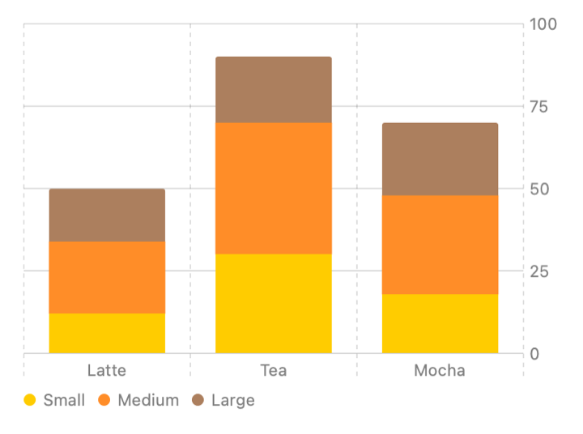
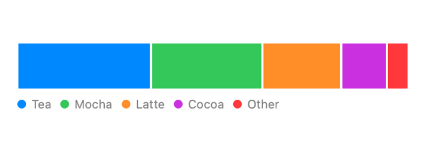
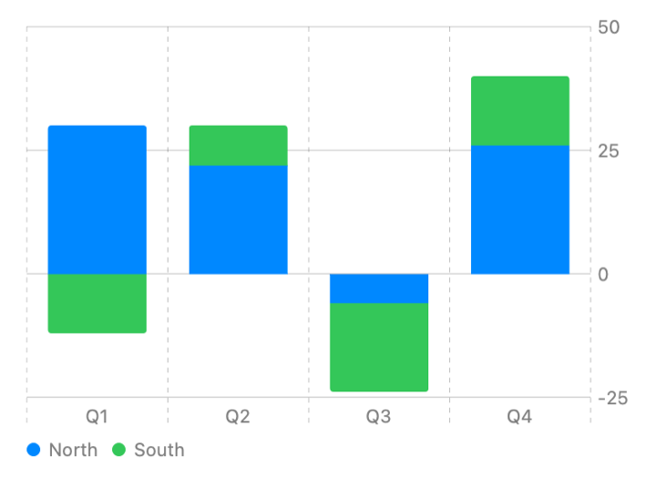

# Stacked bar chart



## Visual signature

A bar chart where each bar is divided into coloured segments stacked on top of each other, so the bar's full height is the total. A legend below the chart names each colour. The same colours appear in the same order in every bar.

## Composition

- The data has one row per segment: category, sub-category, amount.
- `BarMark` with the category and amount, plus `foregroundStyle(by:)` on the sub-category. That one modifier splits the bars, stacks the segments, assigns colours and adds the legend. Minimum iOS 16.0.
- `chartForegroundStyleScale` to choose the colours.

<!-- snippet: Gallery/StackedBarChart.swift#scale -->
```swift
Chart(orders) { order in
    BarMark(
        x: .value("Drink", order.drink),
        y: .value("Cups", order.cups)
    )
    .foregroundStyle(by: .value("Size", order.size))
}
.chartForegroundStyleScale([
    "Small": .yellow, "Medium": .orange, "Large": .brown,
])
```

## Variations

**Default colours.** Leave off `chartForegroundStyleScale` and the framework assigns blue, green, orange and so on in data order. Fine when the sub-categories have no colour of their own.

**A single bar.** Leave out the category: `BarMark(x:)` puts every segment end to end in one horizontal bar, an alternative to a pie for parts of a whole.


<!-- snippet: Gallery/StackedBarChart.swift#single -->
```swift
struct SingleStackedBar: View {
    let shares: [DrinkSales]

    var body: some View {
        Chart(shares) { share in
            BarMark(x: .value("Cups", share.cups))
                .foregroundStyle(by: .value("Drink", share.drink))
        }
        .chartXAxis(.hidden)
        .frame(height: 64)
    }
}
```

**Separated segments.** A strip of empty space between segments helps people see each one, as in the iPhone Storage bar. Clip each mark to a slightly inset rectangle. The inset comes off every side: neighbours are twice the inset apart (1.5 leaves 3 points), and the whole bar is that much shorter and narrower.



<!-- snippet: Design/HIGPatterns.swift#separated -->
```swift
struct SeparatedStackedBar: View {
    let shares: [DrinkSales]

    var body: some View {
        Chart(shares) { share in
            BarMark(x: .value("Cups", share.cups))
                .foregroundStyle(by: .value("Drink", share.drink))
                // A strip of empty space between neighbouring segments.
                .clipShape(Rectangle().inset(by: 1))
        }
        .chartXAxis(.hidden)
        .frame(height: 64)
    }
}
```

**Positive and negative values.** Negative segments stack downward from zero, so each bar shows gains above the line and losses below it.



<!-- snippet: Marks/MarkConfiguration.swift#diverging -->
```swift
struct DivergingStackedBars: View {
    let results: [Regional]

    var body: some View {
        Chart(results) { result in
            BarMark(x: .value("Quarter", result.quarter), y: .value("Profit", result.profit))
                .foregroundStyle(by: .value("Region", result.region))
        }
    }
}
```

## Accessibility

By default each bar is one element, read as its total and the number of categories ("Latte, total 50, 3 Sizes"). To make each segment an element, wrap the mark in a labelled `Plot`; this chart is the worked example in `../accessibility.md`. A single bar divided into parts has no automatic Audio Graph: give it a chart descriptor (`../audio-graph.md`), its range 0 to the total.

**Colour is not enough on its own.** Bars have no symbol or dash, so the second cue is a direct label on each segment (`annotation(position: .overlay)`, legend hidden). Where a segment is too narrow for its label, say on screen what is given up. On the system palette white labels measured 2.2 to 4.2:1, black 5 to 10:1.

## Pitfalls

- **Default colours can contradict the data.** If the sub-categories are themselves colours, or have a colour people expect (brand colours, red for errors), the automatic assignment will mislabel them. Set the scale explicitly.
- **Stacking order and legend order are set in different places.** Segments stack bottom to top in the order the sub-categories first appear in the data. The legend follows the order written in `chartForegroundStyleScale`. Write the scale in the same order as the data, or the legend will read in a different order from the bars.
