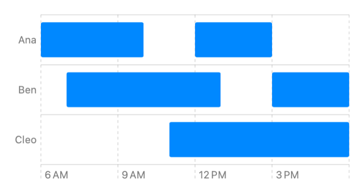
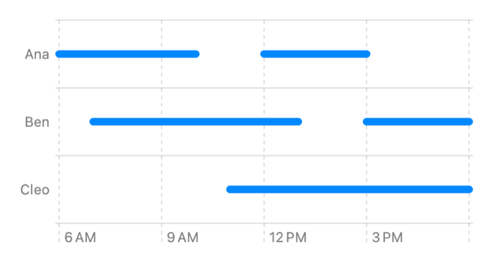

# Timeline (Gantt chart)



## Visual signature

Rows labelled with names or tasks, and in each row one or more horizontal bars that start and end at different positions along a time (or number) axis. Bars do not share a baseline, and a row can hold several bars with gaps between them. Not this form if every bar starts at the axis (`bar.md`), or if the bars are vertical and one per category (`range-bar.md`).

## Composition

- `BarMark(xStart:xEnd:y:)`: the interval on x, the row on y. One mark per interval; a row gets as many bars as it has elements. Minimum iOS 16.0.
- Row labels moved outside the plot with `AxisMarks(preset: .aligned, position: .leading)`. By default they are drawn inside the plot, above each row's bars.

<!-- snippet: Gallery/TimelineChart.swift#recipe -->
```swift
struct TimelineChartRecipe: View {
    let shifts: [Shift]

    var body: some View {
        Chart(shifts) { shift in
            BarMark(
                xStart: .value("Start", shift.start),
                xEnd: .value("End", shift.end),
                y: .value("Barista", shift.barista)
            )
        }
        .chartYAxis {
            AxisMarks(preset: .aligned, position: .leading)
        }
    }
}
```

## Variations

**Thin lines.** `RuleMark(xStart:xEnd:y:)` with a `lineStyle` gives a lighter chart with rounded ends.



<!-- snippet: Gallery/TimelineChart.swift#rules -->
```swift
struct RuleTimeline: View {
    let shifts: [Shift]

    var body: some View {
        Chart(shifts) { shift in
            RuleMark(
                xStart: .value("Start", shift.start),
                xEnd: .value("End", shift.end),
                y: .value("Barista", shift.barista)
            )
            .lineStyle(StrokeStyle(lineWidth: 6, lineCap: .round))
        }
        // Half the line's width at each end, so a round cap at the edge of the scale stays in the plot.
        .chartXScale(range: .plotDimension(padding: 3))
        .chartYAxis {
            AxisMarks(preset: .aligned, position: .leading)
        }
    }
}
```

**Coloured by status or owner:** add `foregroundStyle(by:)`.

**Vertical:** `BarMark(x:yStart:yEnd:)`.

**Many intervals** (iOS 18.0+): `RectanglePlot` or `RulePlot` (`../vectorized-plots.md`).

## Accessibility

By default each row is one element that says only its name, with no start, end or duration, and there is no automatic Audio Graph. Wrap each bar in a `Plot` labelled with the row's name and valued with its start and end, and write a chart descriptor (`../accessibility.md`, `../audio-graph.md`).

## Pitfalls

- A round line cap extends past the rule's end values by half the line width, and runs past the plot's edge, over the axis, when an interval starts or ends at the edge of the scale; pad the scale's range by half the line width (`../scales.md`, `.plotDimension(padding:)`).
