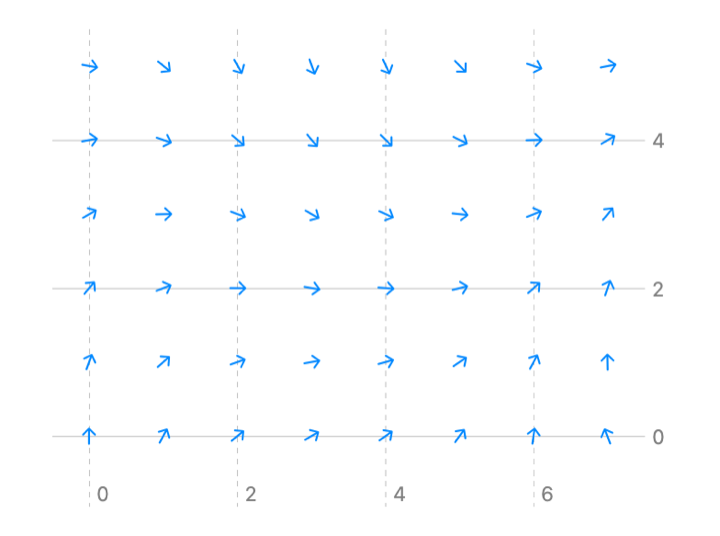

# Vector field



## Visual signature

A regular grid of small arrows (or other directional symbols), each rotated to show a direction at that position: wind, current, slope.

## Composition

- `PointMark` at each grid position, with a view as its symbol: `symbol { }` takes any SwiftUI view, here an arrow image rotated by the data. Minimum iOS 16.0.

<!-- snippet: Sessions/SessionPatterns.swift#vector-field -->
```swift
struct VectorFieldRecipe: View {
    let wind: [Wind]

    var body: some View {
        Chart(wind) { item in
            PointMark(x: .value("Across", item.x), y: .value("Along", item.y))
                .symbol {
                    // A view symbol is drawn as written: size and colour encodings do not reach it.
                    Image(systemName: "arrow.up")
                        .font(.caption2)
                        .rotationEffect(.degrees(item.direction))
                }
        }
        // A unit must be as long across as up, or every slanted arrow points the wrong way:
        // both domains are fixed, half a step past the grid, and the plot takes their shape.
        .chartXScale(domain: -0.5 ... 7.5)
        .chartYScale(domain: -0.5 ... 5.5)
        .chartPlotStyle { $0.aspectRatio(8.0 / 6.0, contentMode: .fit) }
    }
}
```

## Pitfalls

- Arrows on the outermost grid positions are cut off at the plot edge; fix each domain half a grid step past the outermost positions, as the recipe does (`../scales.md`).
- Unequal units on the two axes turn every slanted arrow: with a plot wider than it is tall, a 45° arrow is drawn pointing at a different place on the grid. Fix both domains and give the plot their shape, width over height, as the recipe does (`../plot-area.md`).
- `symbolSize(by:)` and `foregroundStyle(by:)` do not reach a view used as a symbol, but each still draws a legend, which then describes sizes or colours that are not there. To show a strength, size or colour the view yourself in the `symbol { }` closure from the data, on one fixed maximum, and draw a key beside the chart.
- In a right-to-left layout a rotated symbol is mirrored with the axis, so do not negate the angle yourself.

## Accessibility

By default the field is read as columns of positions, one element per column ("1 to 2", "varies between 1 and 7, 4 values"), and the automatic Audio Graph has one unnamed series of the grid positions. The direction is in neither (read on iOS). Wrap each point in a `Plot` labelled with the position in words and valued with the direction and strength, and write a chart descriptor (`../audio-graph.md`).
